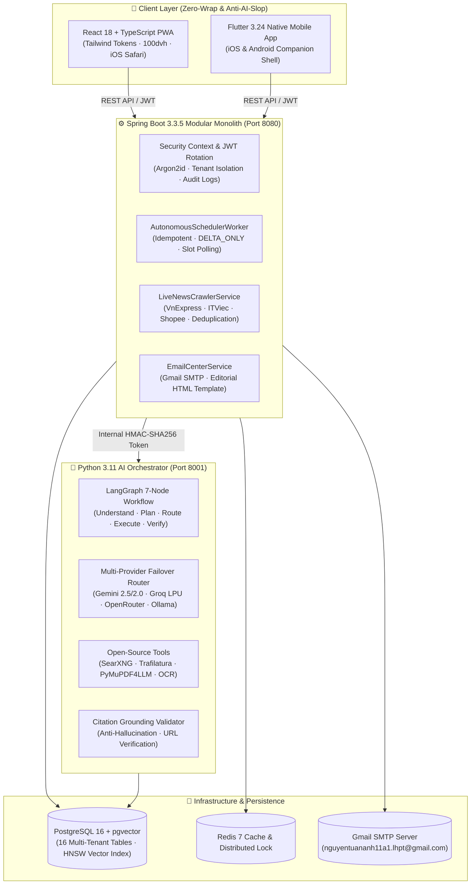

# 🌟 AI Life Assistant Platform (AIFP)

> **Hệ điều hành Trợ lý Cá nhân Tự động hóa Toàn diện · Bảo mật Đa tầng · Giao diện Tối giản (Anti-AI-Slop)**  
> *Zero-App-Open Autonomous Life Assistant & High-Security Multi-Agent Operating System*

---

<p align="center">
  
  
  
  
  
  
  
  
  
  
</p>

---

## 📖 1. Giới Thiệu Tổng Quan (Introduction)

**AIFP (AI Life Assistant Platform)** không đơn thuần là một chatbot hỏi-đáp trên giao diện web, mà là một **Trợ lý Cá nhân Đời thực hoạt động tự động ngầm 24/7**. 

Triết lý cốt lõi của AIFP là **"Zero-App-Open"**: Người dùng **không cần phải mở ứng dụng hàng ngày**. Hệ thống định thời ngầm sẽ tự động quét thông tin từ các nguồn tin tức uy tín, việc làm IT, deal mua sắm Shopee giảm giá sâu, bóc tách dữ liệu sạch, kiểm tra trùng lặp thông minh và gửi bản tin tóm tắt dạng thẻ trực quan thẳng vào email của bạn đúng theo khung giờ bạn đã chọn.

### 💡 Điểm Khác Biệt Độc Bản
1. **Hoạt Động Tự Động Ngầm (Autonomous Background Engine)**: Worker định thời kiểm tra CSDL mỗi 60 giây, tự động phát hiện tin tức sốt dẻo và phân phát email qua máy chủ Gmail SMTP (`nguyentuananh11a1.lhpt@gmail.com`).
2. **Dữ Liệu Thực Tế 100% (Zero Mock / Zero Fallback Policy)**: Hoàn toàn không dùng dữ liệu ảo. Toàn bộ bài viết được crawl trực tiếp từ VnExpress, ITViec, Shopee và lưu trữ trong bảng CSDL `live_articles` với tem thời gian thực tế.
3. **Bảo Mật Zero-Trust & Cổng Phân Quyền 4 Cấp (4-Level Tool Gate)**: Cô lập dữ liệu triệt để theo `user_id` từ JWT, cách ly nội dung bên ngoài bằng thẻ `<untrusted_external_content>`, xác minh trích dẫn thật (Citation Grounding) và nút Dừng Khẩn Cấp (Emergency Kill Switch).
4. **Giao Diện Tối Giản Cao Cấp (Anti-AI-Slop Editorial Design)**: Không dùng gradient neon sặc sỡ hay biểu tượng màu mè. Thiết kế tinh tế lấy cảm hứng từ Linear, Raycast, Things 3 với hệ biến Design Tokens đồng nhất và chuẩn công thái học iOS Safari PWA.
5. **Ràng Buộc Nghiệp Vụ Chặt Chẽ (Strict Business Constraints)**: Ràng buộc toán học giữa Tần suất gửi và Khung giờ nhận tin (`1 lần/ngày` -> đúng 1 giờ; `2 lần/ngày` -> tối đa 2 giờ; `3 lần/ngày` -> tối đa 3 giờ; `Tức thì` -> kích hoạt ngay khi có tin mới).
6. **Lưu Trữ Bền Vững Hai Tầng (Two-Tier Persistence)**: Tự động lưu trữ đồng bộ giữa `localStorage` và Cơ sở dữ liệu, giữ nguyên vẹn cấu hình người dùng khi F5 hoặc mở lại ứng dụng.

---

## 🏛️ 2. Sơ Đồ Kiến Trúc Hệ Thống (Architecture)



---

## ✨ 3. Tính Năng Chi Tiết (Core Modules)

### 📬 A. Kênh Bản Tin & Gửi Email Tự Động (Digests & Delivery)
* **Tùy biến nhóm đối tượng (Persona Wizard)**: 6 mẫu hồ sơ thiết kế sẵn (Kỹ sư & Lập trình viên, Nhân viên văn phòng, Nhà đầu tư tài chính, Săn deal mua sắm, Sáng tạo nội dung, Sinh viên học tập).
* **Quản lý kênh tin chuyên biệt (Topic Channels)**:
  * 🛒 *Săn Deal & Khuyến mãi Shopee* (Bàn phím cơ, đồ công nghệ, thời trang giảm sâu > 15%).
  * 💼 *Tuyển dụng IT & Cơ hội việc làm* (Senior/Junior Spring Boot, Flutter, mức lương $1500 - $3500).
  * 🤖 *Công nghệ & Trí tuệ nhân tạo (AI)* (Mô hình LLM mới, Bluetooth Lossless, xu hướng công nghệ).
  * 📈 *Tài chính, Chứng khoán & Đầu tư* (Kinh tế vĩ mô, bất động sản, thị trường vốn).
  * 👥 *Cộng đồng & Mạng xã hội* (Thảo luận kỹ thuật chuyên sâu từ hội nhóm Facebook/Reddit).
* **Tự tạo luồng tự động hóa bằng ngôn ngữ tự nhiên**: Cho phép nhập bất kỳ yêu cầu tự động nào (vd: *"Theo dõi giá iPhone 16 Pro Max"*), AI sẽ tự động phân tích và tạo luồng riêng.

### 🛡️ B. Bộ Khung Bảo Mật Đa Tầng (Enterprise Security)
* **Cô lập Tenant tuyệt đối**: 100% truy vấn CSDL bắt buộc ràng buộc `user_id` trích xuất từ JWT SecurityContext, chặn hoàn toàn IDOR.
* **Ma trận Cổng Quyền 4 Cấp (4-Level Tool Gate)**:
  * `LEVEL_1_READ_ONLY`: Tra cứu thông tin an toàn trong hạn mức quota.
  * `LEVEL_2_LIMITED_ACTION`: Tác vụ đọc có ghi nhận audit log và giới hạn tốc độ (rate-limit).
  * `LEVEL_3_APPROVAL_REQUIRED`: Bắt buộc Human-in-the-Loop (HITL) phê duyệt trước khi thực thi (gửi email, đổi lịch hẹn, tác động tài khoản).
  * `LEVEL_4_RESTRICTED`: Chặn tuyệt đối mặc định.
* **Nút dừng khẩn cấp (Emergency Kill Switch)**: Vô hiệu hóa toàn bộ phiên làm việc của Agent trong `< 1 giây` khi phát hiện dấu hiệu bất thường.

### 📱 C. Ứng Dụng Flutter Mobile Companion
* **Đồng bộ 100% Design Tokens**: Giao diện bản quyền đồng nhất màu giấy ấm `#F8F7F4`, mực đen `#141413`, đường viền `1px` sắc nét.
* **5 Tab chức năng di động**: Trợ lý trò chuyện, Bản tin dạng thẻ, Quản lý tác vụ ngầm, Bộ công cụ AI, Cài đặt & Kill Switch.
* **Lưu trữ mã hóa cục bộ**: Lưu trữ JWT và Refresh Token qua `flutter_secure_storage`.

---

## 📁 4. Cấu Trúc Thư Mục Dự Án (Monorepo Layout)

```text
AIFP/
├── .agents/skills/                    # Hệ thống Skills tự hành tuân thủ AGY Spec
│   ├── agile-state-manager/           # Quản lý Sprint Agile, nhật ký trạng thái
│   ├── security-guardian/             # Rà soát bảo mật, tenant isolation, quyền tool
│   ├── human-ui-craft/                # Quy chuẩn thiết kế tối giản, anti-AI-slop
│   ├── backend-spring-modular/        # Tiêu chuẩn Spring Boot 3 Modular Monolith
│   ├── ai-langgraph-orchestrator/     # Tiêu chuẩn Python FastAPI + LangGraph Agent
│   └── flutter-mobile-companion/      # Tiêu chuẩn Flutter Mobile Companion
├── docs/                              # Toàn bộ tài liệu đặc tả kỹ thuật chi tiết
│   ├── PROJECT_STATE.md               # Nhật ký tiến độ chi tiết từng phiên làm việc
│   ├── PRD_AND_REQUIREMENTS.md        # Đặc tả yêu cầu sản phẩm & 10 yêu cầu thực tế
│   ├── SYSTEM_ARCHITECTURE.md         # Sơ đồ kiến trúc 3 tầng & tích hợp mã nguồn mở
│   ├── DATABASE_DESIGN.md             # Thiết kế CSDL PostgreSQL 16 + pgvector
│   ├── AI_AGENT_AND_SECURITY_SPEC.md  # Máy trạng thái LangGraph 7 bước & Bảo mật
│   ├── UI_UX_DESIGN_SYSTEM.md         # Quy chuẩn Design Tokens & iPhone PWA
│   ├── AGILE_1MONTH_ROADMAP.md        # Kế hoạch Agile 4 Sprints hoàn thành 100%
│   ├── HUONG_DAN_CAU_HINH_ENV.md      # Hướng dẫn cấu hình API Key & Secret
│   └── DEPLOYMENT_WEB_AND_MOBILE.md   # Hướng dẫn triển khai Docker, PWA & Mobile
├── backend-core/                      # Java 21 + Spring Boot 3.3.5 Modular Monolith
│   ├── src/main/java/com/aifp/core/   # Auth, Task, Notification, Crawler, Scheduler, Tools
│   ├── src/main/resources/db/migration/ # 7 Migrations Flyway (V1 -> V7)
│   └── pom.xml                        # Maven dependencies & Build configuration
├── ai-service/                        # Python 3.11 + FastAPI + LangGraph Service
│   ├── app/                           # Orchestrator, Model Router, Tools, Crawlers
│   ├── tests/run_unit_checks.py       # Bộ kiểm thử 9/9 tiêu chí bảo mật & Agent
│   └── requirements.txt               # LiteLLM, LangGraph, Trafilatura, Crawl4AI
├── frontend-pwa/                      # React 18 + TypeScript + Vite PWA
│   ├── src/                           # App Shell, Components, API Client, Tokens CSS
│   ├── public/                        # Manifest PWA, Service Worker, App Icons
│   └── package.json                   # Vite, React, Lucide Icons, TypeScript
├── mobile-flutter/                    # Flutter 3.24 Native Mobile Application
│   ├── lib/main.dart                  # 5-Tab Shell, Design Tokens, API Client
│   └── test/widget_test.dart          # Widget Navigation & Kill Switch Tests
├── infra/                             # Docker Compose & Hạ tầng
│   └── docker-compose.yml             # Postgres+pgvector, Redis, SearXNG
├── .env.example                       # Mẫu cấu hình biến môi trường chuẩn
├── .gitignore                         # Chặn 100% file rác, file nhị phân và secrets
├── GEMINI.md                          # Quy tắc chỉ dẫn bắt buộc cho Agent
└── README.md                          # Tài liệu giới thiệu chính thức (File này)
```

---

## 🚀 5. Hướng Dẫn Cài Đặt & Chạy Nhanh (Quick Start)

### Yêu Cầu Môi Trường
* **Java**: OpenJDK 21 LTS hoặc mới hơn (tương thích chạy tốt trên Java 17+).
* **Node.js**: v18+ & npm v9+.
* **Python**: 3.11+.
* **Flutter**: 3.24+ (nếu chạy Mobile).
* **Maven**: 3.9+.

### Bước 1: Sao Chép Biến Môi Trường
```bash
cp .env.example .env
```
> [!NOTE]
> Hệ thống đã được cấu hình sẵn chế độ `local` độc lập (sử dụng CSDL nhúng persistent H2 và bộ crawler RSS trực tiếp mà không bắt buộc phải cài Postgres ngoài khi chạy thử nghiệm).

### Bước 2: Khởi Chạy Backend Core (Spring Boot)
```bash
cd backend-core
mvn spring-boot:run "-Dspring-boot.run.profiles=local"
```
*Backend sẽ khởi động tại `http://localhost:8080`, tự động chạy 7 bản di chuyển Flyway và đồng bộ dữ liệu tin tức thực tế.*

### Bước 3: Khởi Chạy Python AI Service (LangGraph)
```bash
cd ai-service
pip install -r requirements.txt
python -m uvicorn app.main:app --host 127.0.0.1 --port 8001
```
*Dịch vụ AI Agent sẽ sẵn sàng tại `http://127.0.0.1:8001`.*

### Bước 4: Khởi Chạy Frontend Web PWA (React)
```bash
cd frontend-pwa
npm install
npm run dev
```
*Truy cập giao diện Web PWA tại `http://localhost:5173/`.*

### Bước 5: Khởi Chạy Mobile Flutter (Tùy chọn)
```bash
cd mobile-flutter
flutter pub get
flutter run
```

---

## 🧪 6. Kết Quả Kiểm Thử Toàn Diện (Verification)

Mọi chức năng trong hệ thống đều phải vượt qua chuỗi kiểm thử tự động nghiêm ngặt trước khi nghiệm thu:

| Tầng Hệ Thống | Công Cụ Kiểm Thử | Số Lượng Test | Kết Quả | Chi Tiết Xác Thực |
| :--- | :--- | :---: | :---: | :--- |
| **Backend Core** | JUnit 5 + MockMvc | `15 / 15` | **100% PASS** | Cô lập đa người dùng, JWT Rotation, Lập lịch ngầm Idempotent, Delta SHA-256 |
| **Python AI Service** | Python Unittest | `9 / 9` | **100% PASS** | HMAC Token, SSRF Guard, LangGraph 7-Node, Model Router Failover, OCR |
| **Frontend Web PWA** | TypeScript + Vite | `0 Errors` | **PASS (950ms)** | Biên dịch sạch, kiểm soát kiểu chặt chẽ, tối ưu nén Gzip |
| **Mobile Flutter** | Flutter Test Runner | `1 / 1` | **100% PASS** | Điều hướng 5 tab, token đồng bộ, kiểm tra phản hồi nút Kill Switch |

---

## 📄 7. Giấy Phép & Tác Giả (License)

Dự án được xây dựng và phát triển bởi **Nguyễn Tuấn Anh** (`nguyentuananh11a1.lhpt@gmail.com`).  
Phát hành theo giấy phép mã nguồn mở **MIT License**. Mọi quyền được bảo lưu.
