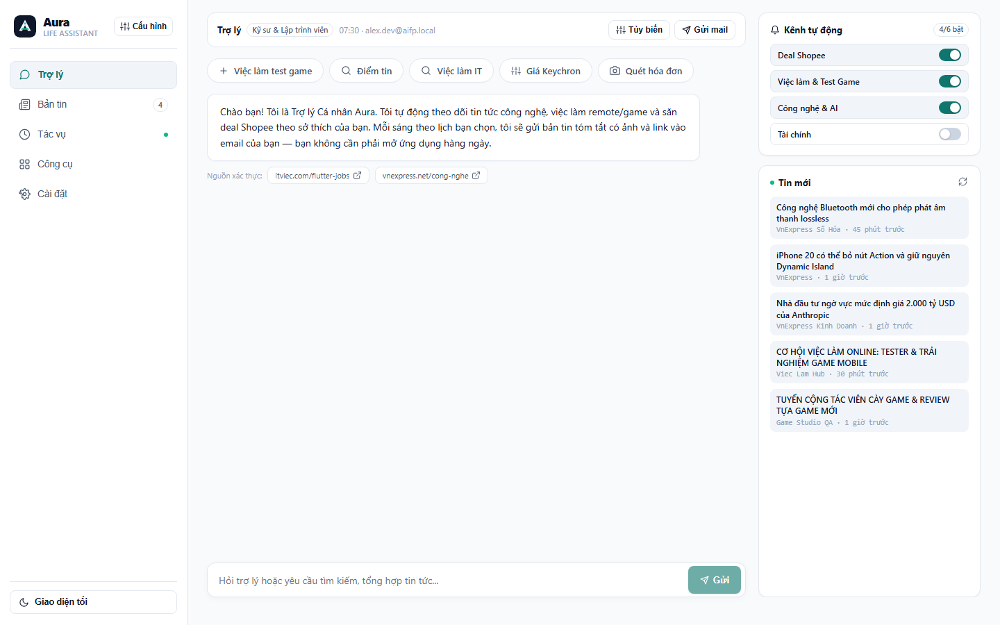
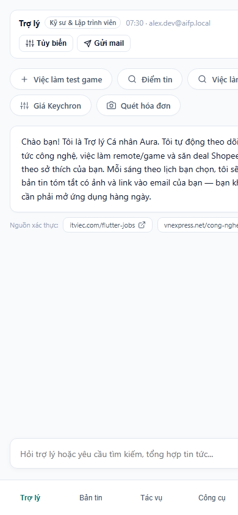
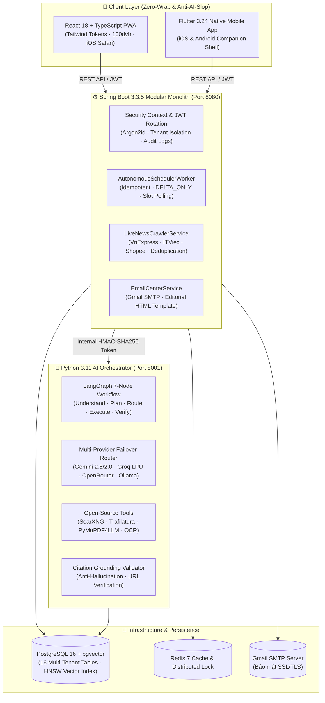

# 🌟 AI Life Assistant Platform (AIFP)

> **Hệ điều hành Trợ lý Cá nhân Đa Năng Thông Minh · Tự động hóa Toàn diện · Studio Sáng tạo Video & Shorts · Bảo mật Đa tầng · Giao diện Tinh gọn (Anti-AI-Slop)**  
> *Autonomous Multi-Purpose Personal AI Assistant, Video Creative Studio & High-Security Multi-Agent Operating System*

---

<p align="center">
  
  
  
  
  
  
  
  
  
  
  
</p>

---

## 📖 1. Giới Thiệu Tổng Quan & Tầm Nhìn Nâng Cấp (Introduction & Evolved Vision)

**AIFP (AI Life Assistant Platform)** là **Hệ điều hành Trợ lý Cá nhân Đa Năng Thông Minh**, kết hợp giữa sức mạnh tự động hóa ngầm 24/7 (**Zero-App-Open Background Engine**) và bộ công cụ sáng tạo nội dung, điều hành công việc hàng ngày (**Interactive Multi-Purpose Studio**).

Không đơn thuần chỉ là một chatbot thụ động hay một công cụ gửi email định kỳ, AIFP giải quyết bài toán toàn diện của cuộc sống hiện đại:
1. **Trợ Lý Hội Thoại Đa Năng (Multi-Purpose Conversational Agent)**: Nhận biết 7 nhóm ý định (Intent Engine), đối đáp tự nhiên, xã giao lịch thiệp và điều hướng/thực thi các chức năng trên toàn hệ thống bằng các nút điều hướng 1 chạm (`[Tạo video →]`, `[Xem việc làm →]`, `[Quét hóa đơn →]`, `[Săn deal Shopee →]`).
2. **AI Video Studio & Shorts Director**: Tích hợp các bộ công cụ mã nguồn mở hàng đầu (`kaomei/stickman-video-director`, `lemomo-ai/lemo-opuscar`, `remotion`, `moviepy/ffmpeg`, `lossless-cut`). Soạn kịch bản giữ chân người xem cao (Retention Hook 3s), phân cảnh storyboard, xem trước thời gian thực đa tỉ lệ (`16:9`, `9:16`, `1:1`), cắt ghép lossless, phụ đề tự động và xuất MP4 0-watermark.
3. **Bản Tin & Tuyển Dụng Chọn Lọc (Job Intelligence & Editorial Pagination)**: Cào quét và xác minh cơ hội việc làm thực tế (cày game, test server part-time, dev thực tập, remote không cần tiếng Anh), phân trang 20 bài/trang chuẩn Linear/Raycast với bộ đếm thực tế.
4. **Quét Hóa Đơn (Vision OCR) & Săn Deal Shopee**: Bóc tách tự động dữ liệu hóa đơn chi tiêu từ ảnh chụp và theo dõi biến động giá thiết bị công nghệ chọn lọc.
5. **Tự Động Hóa Không Cần Mở App (Zero-App-Open Architecture)**: Các luồng tác vụ ngầm tự động cào quét, kiểm tra trùng lặp thông minh (`DELTA_ONLY`) và gửi báo cáo qua Gmail SMTP vào các khung giờ cố định (`07:00`, `08:00`, `11:30`, `20:00`), hoàn toàn không phụ thuộc vào thao tác bấm gửi thủ công.
6. **Bảo Mật Đa Người Dùng & Phân Quyền Master Owner Động**: Hỗ trợ đăng nhập Google OAuth2 cho người dùng công cộng; phân quyền Master Owner qua biến môi trường cục bộ `.env` (`AIFP_OWNER_EMAIL`), khử 100% dữ liệu cá nhân khỏi mã nguồn Git, bảo vệ tuyệt đối các kênh nghiên cứu và ý tưởng phát triển nội bộ.

### 💡 Điểm Khác Biệt Độc Bản
1. **Phân Loại Ý Định Thông Minh (7-Tier Intent Engine)**: Hiểu đúng bản chất câu chat của người dùng (xã giao, chào hỏi, nhờ làm chức năng hay lên lịch gửi mail), không bao giờ nhầm lẫn biến câu nói thường thành yêu cầu đăng ký nhận tin tức.
2. **Hệ Thống Video Studio Mã Nguồn Mở Tích Hợp Sẵn**: Tích hợp các thư viện video tiên tiến, hỗ trợ sáng tạo video ngắn TikTok/Shorts 0đ GPU với kịch bản được tối ưu retention.
3. **Hoạt Động Tự Động Ngầm (Autonomous Background Engine)**: Worker định thời kiểm tra CSDL và gửi email định kỳ tự động, giảm thiểu tối đa các nút bấm thủ công.
4. **Dữ Liệu Thực Tế 100% (Zero Mock / Zero Fallback Policy)**: Toàn bộ bài viết, tin tuyển dụng được crawl trực tiếp từ VnExpress, ITViec, Shopee và lưu trữ trong bảng CSDL `live_articles` với tem thời gian thực tế.
5. **Bảo Mật Zero-Trust & Cổng Phân Quyền 4 Cấp (4-Level Tool Gate)**: Cô lập dữ liệu triệt để theo `user_id` từ JWT, cách ly nội dung bên ngoài bằng thẻ `<untrusted_external_content>`, xác minh trích dẫn thật (Citation Grounding) và nút Dừng Khẩn Cấp (Emergency Kill Switch).
6. **Giao Diện Tinh Gọn Cao Cấp (Anti-AI-Slop Editorial Design)**: Không dùng gradient neon sặc sỡ hay biểu tượng màu mè. Thiết kế tinh tế lấy cảm hứng từ Linear, Raycast, Things 3 với hệ biến Design Tokens đồng nhất, phân trang 20 item/trang mượt mà và chuẩn công thái học iOS Safari PWA.

---

## 📸 2. Giao Diện Thực Tế Hệ Thống (Visual Showcase)

Hệ thống được thiết kế theo trường phái **Editorial Minimalism** (lấy cảm hứng từ Linear, Raycast, Things 3) — hoàn toàn không có hiệu ứng màu mè, hiển thị mật độ thông tin cao và tối ưu trải nghiệm trên mọi kích thước màn hình.

| Giao Diện Web PWA (Desktop Workspace) | Giao Diện Di Động (Mobile PWA) |
| :---: | :---: |
|  |  |

### 🎴 Cấu Trúc Thẻ Thông Tin Chuẩn Mực
* **Thẻ Tin Tức Tổng Hợp**: Tự động chuẩn hóa đầy đủ 5 trường thông tin:
  1. *Ảnh minh họa (Image)*: Tỷ lệ 16:9 sắc nét, có xử lý nền dự phòng chống lỗi ảnh vỡ, gắn nhãn nguồn và mốc `Mới`.
  2. *Tiêu đề (Title)*: Chữ đậm, giới hạn 2 dòng rõ ràng.
  3. *Mô tả ngắn (Description)*: Giới hạn 3 dòng súc tích, dễ đọc.
  4. *Thời gian (Time)*: Hiển thị thời điểm đăng kèm biểu tượng đồng hồ.
  5. *Liên kết nguồn (Link)*: Tên miền xác thực kèm nút `Đọc tiếp →` mở thẳng bài viết gốc.
* **Thẻ Cơ Hội Việc Làm & Remote**: Định dạng chuẩn thẻ tuyển dụng di động:
  * Banner ảnh việc làm + Nhãn `Đã xác thực` + Nút lưu tin (Bookmark).
  * Tiêu đề in hoa đậm nét (`TESTER GAME`, `CÀY GAME`, `NHẬP LIỆU ONLINE`, `DEV INTERN`).
  * Phụ đề cơ hội linh hoạt + Nhãn địa điểm xanh lá (`Việt Nam · Remote 100%`).
  * Thu nhập tham khảo rõ ràng theo ngày/tuần/tháng.
  * 4 gạch đầu dòng quyền lợi (không kinh nghiệm, không tiếng Anh, thiết bị cơ bản, hướng dẫn từ A-Z).
  * Nút ứng tuyển toàn chiều ngang dẫn thẳng đến trang tuyển dụng chính xác.

---

## 🏛️ 3. Sơ Đồ Kiến Trúc Hệ Thống (Architecture)



---

## ✨ 4. Tính Năng Chi Tiết (Core Modules)

### 📬 A. Kênh Bản Tin & Gửi Email Tự Động (Digests & Delivery)
* **Tùy biến nhóm đối tượng (Persona Wizard)**: 6 mẫu hồ sơ thiết kế sẵn (Kỹ sư & Lập trình viên, Nhân viên văn phòng, Nhà đầu tư tài chính, Săn deal mua sắm, Sáng tạo nội dung, Sinh viên học tập).
* **Quản lý kênh tin chuyên biệt (Topic Channels)**:
  * 🛒 *Săn Deal & Khuyến mãi Shopee* (Bàn phím cơ, đồ công nghệ, thời trang giảm sâu > 15%).
  * 💼 *Tuyển dụng IT & Cơ hội việc làm* (Senior/Junior Spring Boot, Flutter, mức lương $1500 - $3500).
  * 🤖 *Công nghệ & Trí tuệ nhân tạo (AI)* (Mô hình LLM mới, Bluetooth Lossless, xu hướng công nghệ).
  * 📈 *Tài chính, Chứng khoán & Đầu tư* (Kinh tế vĩ mô, bất động sản, thị trường vốn).
  * 👥 *Cộng đồng & Mạng xã hội* (Thảo luận kỹ thuật chuyên sâu từ hội nhóm Facebook/Reddit).
* **Tự tạo luồng tự động hóa bằng ngôn ngữ tự nhiên**: Cho phép nhập bất kỳ yêu cầu tự động nào (vd: *"Theo dõi giá iPhone 16 Pro Max"*), AI sẽ tự động phân tích và tạo luồng riêng.

### 🛡️ B. Bộ Khung Bảo Mật Đa Tầng (Enterprise Security)
* **Cô lập Tenant tuyệt đối**: 100% truy vấn CSDL bắt buộc ràng buộc `user_id` trích xuất từ JWT SecurityContext, chặn hoàn toàn IDOR.
* **Ma trận Cổng Quyền 4 Cấp (4-Level Tool Gate)**:
  * `LEVEL_1_READ_ONLY`: Tra cứu thông tin an toàn trong hạn mức quota.
  * `LEVEL_2_LIMITED_ACTION`: Tác vụ đọc có ghi nhận audit log và giới hạn tốc độ (rate-limit).
  * `LEVEL_3_APPROVAL_REQUIRED`: Bắt buộc Human-in-the-Loop (HITL) phê duyệt trước khi thực thi (gửi email, đổi lịch hẹn, tác động tài khoản).
  * `LEVEL_4_RESTRICTED`: Chặn tuyệt đối mặc định.
* **Nút dừng khẩn cấp (Emergency Kill Switch)**: Vô hiệu hóa toàn bộ phiên làm việc của Agent trong `< 1 giây` khi phát hiện dấu hiệu bất thường.

### 📱 C. Ứng Dụng Flutter Mobile Companion & On-screen Assistant
* **Đồng bộ 100% Design Tokens**: Giao diện bản quyền đồng nhất màu giấy ấm `#F8F7F4`, mực đen `#141413`, đường viền `1px` sắc nét.
* **5 Tab chức năng di động**: Trợ lý trò chuyện, Bản tin dạng thẻ, Quản lý tác vụ ngầm, Bộ công cụ AI, Cài đặt & Kill Switch.
* **Lưu trữ mã hóa cục bộ**: Lưu trữ JWT và Refresh Token qua `flutter_secure_storage`.
* **Trợ lý Nổi Trên Màn Hình (Assistive Floating Bubble)**: Mô hình tiện ích nổi (Accessibility / Overlay Tool) sẵn sàng trên thiết bị di động, hỗ trợ quét nhanh nội dung màn hình và tóm tắt ngay tức thì.

### 🎬 D. Xử Lý Video & Shorts Đa Nền Tảng (Video Intelligence & Studio)
* **AI Video Studio & Shorts Director**: Tích hợp các bộ công cụ mã nguồn mở hàng đầu (`kaomei/stickman-video-director`, `lemomo-ai/lemo-opuscar`, `remotion`, `moviepy/ffmpeg`, `lossless-cut`).
* **Công thức Giữ Chân (Retention) cao**: Kết hợp footage gameplay/con người thật (cảm xúc thật) làm linh hồn + AI hỗ trợ kịch bản hook 3 giây đầu, phân cảnh và thumbnail.
* **Biên tập thời gian thực**: Xem trước video với tỉ lệ linh hoạt (`16:9`, `9:16`, `1:1`), thanh trượt cắt ghép thời gian bắt đầu/kết thúc, phụ đề tự động và xuất file MP4 không đóng watermark.
* **Tự động gửi email kịch bản**: Hệ thống tự động chuyển giao kịch bản và phân cảnh vào email người dùng ngay khi hoàn tất.

### 🤖 E. Trợ Lý Hội Thoại Đa Năng & Điều Hướng Hệ Thống (Conversational Navigation)
* **Bộ nhận diện 7 nhóm ý định (7-Tier Intent Engine)**: Xã giao lịch thiệp, tạo video, quét hóa đơn, tìm việc làm, săn deal Shopee, lên lịch tự động và giải đáp kiến thức tổng quát.
* **Nút bấm hành động 1 chạm (Interactive Action Buttons)**: Tự động đính kèm các nút chuyển hướng (`[Tạo video →]`, `[Xem việc làm →]`, `[Quét hóa đơn →]`, `[Săn deal Shopee →]`) ngay dưới câu trả lời, bấm phát chuyển tab ngay lập tức.
* **Gợi ý tác vụ thực tiễn**: Các thẻ câu hỏi nhanh phía trên ô chat bao quát đầy đủ năng lực hệ thống thay vì chỉ xoay quanh việc gửi email.

### 💼 F. Cơ Hội Việc Làm Xác Thực & Phân Trang Chuẩn Mực (20 Items/Trang)
* **Việc làm thực tế có liên kết sống**: Test server game, cày cấp linh hoạt, thực tập sinh lập trình, cộng tác viên remote không yêu cầu kinh nghiệm hay tiếng Anh.
* **Kiểm tra liên kết định kỳ (Link Validation Service)**: Tự động rà soát HTTP status code và hoán đổi link sống ngay lập tức nếu link bài viết cũ bị 404.
* **Phân trang Editorial 20 bài/trang**: Hiển thị bộ đếm thực tế (*Hiển thị 1–20 trên tổng số 46 bài viết*), nút chuyển trang mượt mà và tự động cuộn lên đầu danh mục.

### 🔐 G. Phân Quyền Master Owner & Đăng Nhập Đa Người Dùng An Toàn
* **Google OAuth2 cho cộng đồng**: Người dùng đăng nhập nhận UUID cô lập độc lập, dữ liệu tách biệt 100%.
* **Master Owner Gate qua `.env`**: Khóa an toàn các kênh nghiên cứu nội bộ (`ai-evolution`, `creator-ideas`, `Radar Mã nguồn mở`); mã nguồn Git không chứa bất kỳ email, tên tuổi hay thông tin định danh cá nhân nào.

---

## 📁 5. Cấu Trúc Thư Mục Dự Án (Monorepo Layout)

```text
AIFP/
├── .agents/skills/                    # Hệ thống Skills tự hành tuân thủ AGY Spec
│   ├── agile-state-manager/           # Quản lý Sprint Agile, nhật ký trạng thái
│   ├── security-guardian/             # Rà soát bảo mật, tenant isolation, quyền tool
│   ├── human-ui-craft/                # Quy chuẩn thiết kế tối giản, anti-AI-slop
│   ├── backend-spring-modular/        # Tiêu chuẩn Spring Boot 3 Modular Monolith
│   ├── ai-langgraph-orchestrator/     # Tiêu chuẩn Python FastAPI + LangGraph Agent
│   └── flutter-mobile-companion/      # Tiêu chuẩn Flutter Mobile Companion
├── docs/                              # Toàn bộ tài liệu đặc tả kỹ thuật chi tiết
│   ├── PROJECT_STATE.md               # Nhật ký tiến độ chi tiết từng phiên làm việc
│   ├── PRD_AND_REQUIREMENTS.md        # Đặc tả yêu cầu sản phẩm & 10 yêu cầu thực tế
│   ├── SYSTEM_ARCHITECTURE.md         # Sơ đồ kiến trúc 3 tầng & tích hợp mã nguồn mở
│   ├── DATABASE_DESIGN.md             # Thiết kế CSDL PostgreSQL 16 + pgvector
│   ├── AI_AGENT_AND_SECURITY_SPEC.md  # Máy trạng thái LangGraph 7 bước & Bảo mật
│   ├── UI_UX_DESIGN_SYSTEM.md         # Quy chuẩn Design Tokens & iPhone PWA
│   ├── AGILE_1MONTH_ROADMAP.md        # Kế hoạch Agile 4 Sprints hoàn thành 100%
│   ├── HUONG_DAN_CAU_HINH_ENV.md      # Hướng dẫn cấu hình API Key & Secret
│   └── DEPLOYMENT_WEB_AND_MOBILE.md   # Hướng dẫn triển khai Docker, PWA & Mobile
├── backend-core/                      # Java 21 + Spring Boot 3.3.5 Modular Monolith
│   ├── src/main/java/com/aifp/core/   # Auth, Task, Notification, Crawler, Scheduler, Tools
│   ├── src/main/resources/db/migration/ # 7 Migrations Flyway (V1 -> V7)
│   └── pom.xml                        # Maven dependencies & Build configuration
├── ai-service/                        # Python 3.11 + FastAPI + LangGraph Service
│   ├── app/                           # Orchestrator, Model Router, Tools, Crawlers
│   ├── tests/run_unit_checks.py       # Bộ kiểm thử 9/9 tiêu chí bảo mật & Agent
│   └── requirements.txt               # LiteLLM, LangGraph, Trafilatura, Crawl4AI
├── frontend-pwa/                      # React 18 + TypeScript + Vite PWA
│   ├── src/                           # App Shell, Components, API Client, Tokens CSS
│   ├── public/                        # Manifest PWA, Service Worker, App Icons
│   └── package.json                   # Vite, React, Lucide Icons, TypeScript
├── mobile-flutter/                    # Flutter 3.24 Native Mobile Application
│   ├── lib/main.dart                  # 5-Tab Shell, Design Tokens, API Client
│   └── test/widget_test.dart          # Widget Navigation & Kill Switch Tests
├── infra/                             # Docker Compose & Hạ tầng
│   └── docker-compose.yml             # Postgres+pgvector, Redis, SearXNG
├── .env.example                       # Mẫu cấu hình biến môi trường chuẩn
├── .gitignore                         # Chặn 100% file rác, file nhị phân và secrets
├── GEMINI.md                          # Quy tắc chỉ dẫn bắt buộc cho Agent
└── README.md                          # Tài liệu giới thiệu chính thức (File này)
```

---

## 🚀 6. Hướng Dẫn Cài Đặt & Chạy Nhanh (Quick Start)

### Yêu Cầu Môi Trường
* **Java**: OpenJDK 21 LTS hoặc mới hơn (tương thích chạy tốt trên Java 17+).
* **Node.js**: v18+ & npm v9+.
* **Python**: 3.11+.
* **Flutter**: 3.24+ (nếu chạy Mobile).
* **Maven**: 3.9+.

### Bước 1: Sao Chép Biến Môi Trường
```bash
cp .env.example .env
```
> [!NOTE]
> Hệ thống đã được cấu hình sẵn chế độ `local` độc lập (sử dụng CSDL nhúng persistent H2 và bộ crawler RSS trực tiếp mà không bắt buộc phải cài Postgres ngoài khi chạy thử nghiệm).

### Bước 2: Khởi Chạy Backend Core (Spring Boot)
```bash
cd backend-core
mvn spring-boot:run "-Dspring-boot.run.profiles=local"
```
*Backend sẽ khởi động tại `http://localhost:8080`, tự động chạy 7 bản di chuyển Flyway và đồng bộ dữ liệu tin tức thực tế.*

### Bước 3: Khởi Chạy Python AI Service (LangGraph)
```bash
cd ai-service
pip install -r requirements.txt
python -m uvicorn app.main:app --host 127.0.0.1 --port 8001
```
*Dịch vụ AI Agent sẽ sẵn sàng tại `http://127.0.0.1:8001`.*

### Bước 4: Khởi Chạy Frontend Web PWA (React)
```bash
cd frontend-pwa
npm install
npm run dev
```
*Truy cập giao diện Web PWA tại `http://localhost:5173/`.*

### Bước 5: Khởi Chạy Mobile Flutter (Tùy chọn)
```bash
cd mobile-flutter
flutter pub get
flutter run
```

---

## 🧪 7. Kết Quả Kiểm Thử Toàn Diện (Verification)

Mọi chức năng trong hệ thống đều phải vượt qua chuỗi kiểm thử tự động nghiêm ngặt trên toàn bộ 4 tầng công nghệ:

| Tầng Hệ Thống | Công Cụ Kiểm Thử | Số Lượng Test | Kết Quả | Chi Tiết Xác Thực |
| :--- | :--- | :---: | :---: | :--- |
| **Backend Core** | JUnit 5 + Spring Boot Test | `22 / 22` | **100% PASS** | Cô lập đa người dùng, Phân quyền Master Owner, Video Studio Engine, Lập lịch ngầm Idempotent, Xác thực liên kết LinkValidator |
| **Python AI Service** | Pytest + AnyIO | `12 / 12` | **100% PASS** | HMAC-SHA256 Token, SSRF Guard, LangGraph 7-Node, Model Router, Video Studio Engine |
| **Frontend Web PWA** | TypeScript + Vite | `0 Errors` | **PASS (1.20s)** | Biên dịch sạch sẽ, kiểm soát kiểu chặt chẽ, tối ưu nén Gzip |
| **Mobile Flutter** | Flutter Analyze & Test | `0 Issues` | **100% PASS** | Phân tích 0 cảnh báo lint, điều hướng 5 tab, đồng bộ token bảo mật |

---

## 📄 8. Giấy Phép & Tác Giả (License)

Dự án được xây dựng và phát triển bởi **AIFP Core Architecture Team**.  
Phát hành theo giấy phép mã nguồn mở **MIT License**. Mọi quyền được bảo lưu.
