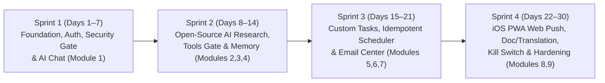
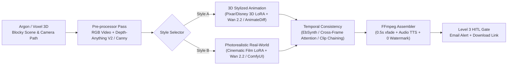

# 1-Month Agile Execution Roadmap (Target: >= 56% Platform Completion in 4 Sprints)

**Methodology**: Agile Scrum (4 Sprints × 1 Week = 30 Days)  
**Target Scope**: Complete **10 / 17 Total Platform Modules** = **100% of P0 MVP (7/7 modules)** + **3 High-Value P1 Modules (`AI Tools Registry`, `Document & Translation Assistant`, `M17: 3D Scene-to-Stylized Video Studio`)**  
**Quality Bar**: Production-grade security (`user_id` isolation, 4-Level Tool Gate, Citation Grounding) + Bespoke Anti-AI-Slop UI + iOS Safari PWA + Zero AI Watermark.

---

## 1. Agile Velocity & Sprint Overview

| Sprint | Duration | Modules Delivered | Cumulative Completion (of 16 Modules) |
| :--- | :---: | :--- | :---: |
| **Sprint 1** | Week 1 (Days 1–7) | Infrastructure, Multi-Tenant Auth, **M1: AI Chat & Model Router** | `1 / 16` (`6.25%` + Core Infra) |
| **Sprint 2** | Week 2 (Days 8–14) | **M2: Personal Memory**, **M3: AI Research (SearXNG)**, **M4: AI Tools & 4-Level Gate** | `4 / 16` (`25.00%`) |
| **Sprint 3** | Week 3 (Days 15–21) | **M5: Custom Tasks**, **M6: Idempotent Scheduler & Worker**, **M7: Email Center** | `7 / 16` (`43.75%`) |
| **Sprint 4** | Week 4 (Days 22–30) | **M8: Notification Center & iOS PWA Push**, **M9: Document & Translation Assistant**, Security Hardening | **`9 / 16` (`56.25%` — Target Met)** |

---

## 2. Detailed Sprint Backlog & Task Checklists

### Sprint 1 (Week 1): Core Foundation, Security Gate & AI Chat

**Sprint Goal**: User can register/login on a clean minimalist Web UI, manage sessions securely, and have multi-turn streaming conversations routed through Spring Boot to the Python LangGraph service.

- [x] **S1-T1: Monorepo & Open-Source Infra Setup (`Days 1–2`)**
  - Create directory structure: `backend-core/` (Spring Boot 3, Java 17/21), `ai-service/` (Python 3.11+, FastAPI, LangGraph), `frontend-pwa/` (React 18, TypeScript, Vite), `mobile-flutter/` (Flutter 3.x), `infra/docker-compose.yml`.
  - Configure Docker Compose with: `postgres:16` (`pgvector/pgvector:pg16`), `redis:7-alpine`, `searxng/searxng:latest` (JSON format enabled), `minio/minio`.
- [x] **S1-T2: Database Schema & Flyway Migration (`Day 2`)**
  - Implement `V1__init_core_schema.sql` & `V2__seed_agents_and_tools.sql` with all 16 core tables, `refresh_tokens`, indexes, and constraints from [`docs/DATABASE_DESIGN.md`](./DATABASE_DESIGN.md).
- [x] **S1-T3: Authentication, Refresh Rotation & Tenant Isolation (`Days 3–4`)**
  - Implement Argon2id password hashing, 15-minute JWT Access Token, and rotating Refresh Token with reuse detection.
  - Create `@AuthenticationPrincipal` tenant isolation and integration test (`SecurityAndTenantIsolationTest`) verifying User A receives `404` when accessing User B's conversation ID.
  - Add `RateLimitFilter` and `EmergencyKillSwitchController`.
- [x] **S1-T4: Python AI Service & Model Router (`Days 5–6`)**
  - Implement HMAC-SHA256 internal signature middleware between Spring Boot and FastAPI.
  - Implement Model Router (`gemini-2.5-flash` default, `gemini-2.5-pro` for complex reasoning, automatic fallback at 80% user daily token quota) and 7-node LangGraph orchestrator.
- [x] **S1-T5: Frontend Design System, AI Chat UI & Mobile Companion Shell (`Days 6–7`)**
  - Implement `tokens.css` (Warm Paper `#F8F7F4` & Dark Carbon `#0C0D0E`, zero AI-slop gradients, 1–3 word buttons).
  - Build `frontend-pwa` (Home, AI Chat, My Tasks, Discover, Inbox HITL Approvals, Settings + Kill Switch) and `mobile-flutter` companion shell.

---

### Sprint 2 (Week 2): Open-Source AI Research, 4-Level Tool Gate & Personal Memory

**Sprint Goal**: AI can search the live web using self-hosted SearXNG + Trafilatura, verify every cited URL, enforce the 4-level tool permission matrix, and manage Personal Memory (`pgvector`).

- [x] **S2-T1: Open-Source Search & Scraper Pipeline (`Days 8–9`)**
  - Build `searxng_search` and `rss_fetch` tools in `ai-service` (`tools_open_source.py`) with SSRF private-IP blocklist and XXE defense.
  - Integrate **Trafilatura** / hardened HTML boilerplate stripper to extract clean Markdown + canonical URL from search results.
  - Wrap all external text in `<untrusted_external_content>` delimiters.
- [x] **S2-T2: Citation Grounding Validator (`Day 10`)**
  - Implement post-synthesis validator that checks every Markdown link `[title](url)` against `state.discovered_urls` and strips hallucinated URLs.
  - Render compact **Source Pills** (`[1] domain.com`) in the frontend chat UI.
- [x] **S2-T3: Tool Registry & 4-Level Permission Gate (`Days 11–12`)**
  - Seed `ai_tools` table with Level 1–4 tools and build `ToolPermissionGateService` & `ApprovalController` (`/api/v1/approvals`) in Spring Boot.
  - Implement **Level 3 HITL Checkpoint**: pausing LangGraph state into `task_approval_requests` (`WAITING_FOR_APPROVAL`) and resuming when user clicks `Duyệt` in UI.
- [x] **S2-T4: Personal Memory Engine (`Days 13–14`)**
  - Implement `PersonalMemoryService` & `PersonalMemoryController` (`/api/v1/memories`) CRUD.
  - Separate `ACTIVE` memories from `CANDIDATE` memories (with 1-click `Lưu` / `Xóa` in UI) and automatic topic conflict superseding (`SUPERSEDED`).

---

### Sprint 3 (Week 3): Custom Tasks, Idempotent Scheduler & Email Center

**Sprint Goal**: Users can type natural language commands to create recurring tasks, and the server autonomously runs them on schedule, deduplicates results (`DELTA_ONLY`), and sends daily Email digests without duplicates.

- [x] **S3-T1: Natural Language to Task Config Parser (`Days 15–16`)**
  - Build `/internal/v1/agent/parse-task` using LangGraph `understand_node` to extract: `title`, `cron_expression`, `timezone` (`Asia/Ho_Chi_Minh`), `delivery_mode` (`DELTA_ONLY`), and required tools.
  - Build inline **Task Proposal Card** in Chat & `Nhiệm vụ (My Tasks)` screen (`[Bật lịch]`, `[Chỉnh sửa]`).
- [x] **S3-T2: Idempotent Scheduler & Distributed Worker (`Days 17–18`)**
  - Implement `IdempotentTaskSchedulerService` in Spring Boot.
  - Enforce `idempotency_key = SHA256(task_id + ":" + scheduled_slot_utc)` and misfire policy (`FIRE_ONCE_WITHIN_WINDOW` `< 2h` vs `SKIPPED_STALE`).
- [x] **S3-T3: Delta Fingerprinting Engine (`Day 19`)**
  - Compute `SHA256(canonical_url + "|" + normalized_title)` for each discovered item; filter out items already delivered in the last 30 runs of `task_id`.
  - If `DELTA_ONLY` and `new_items == 0`, mark `COMPLETED_NO_DELTA` and skip email spam.
- [x] **S3-T4: Email Center & Digest Templates (`Days 20–21`)**
  - Implement `EmailCenterService` with deterministic self-recipient binding (`users.email`) and `UNIQUE (execution_id, recipient_email)` in `email_logs` so worker retries never double-send emails.

---

### Sprint 4 (Week 4): iPhone Safari PWA, Web Push, Document/Translation Assistant & Security Hardening

**Sprint Goal**: Deliver native-like iPhone Safari Home Screen PWA with working Web Push notifications, add Document & Translation Assistant, implement the Emergency Kill Switch, and pass all security/acceptance tests.

- [x] **S4-T1: iPhone Safari PWA & Web Push (VAPID) (`Days 22–24`)**
  - Configure `manifest.webmanifest`, Service Worker (`sw.js`), `100dvh` mobile viewport, and `env(safe-area-inset-bottom)` navigation bar.
  - Build iOS Standalone guide for Safari users and `AES-256-GCM` encrypted VAPID Web Push subscription endpoint (`POST /api/v1/notifications/web-push/subscribe`).
- [x] **S4-T2: Document & Translation Assistant (`Days 25–26`)**
  - Implement `DocumentAndTranslationAssistant` (`ai-service`) and `DocumentAssistantController` (`backend-core`) to parse documents into page-cited chunks (`[Trang N]`) and perform bilingual translation preserving technical terms.
- [x] **S4-T3: Emergency Kill Switch & Security Audit Dashboard (`Days 27–28`)**
  - Implement `POST /api/v1/security/emergency-stop`: pause all active tasks, revoke all refresh tokens, increment `token_version`, and record immutable `CRITICAL` audit logs.
- [x] **S4-T4: End-to-End Security & Reliability Verification (`Days 29–30`)**
  - Execute full automated test suite across all 4 subsystems: `10/10` JUnit integration tests in `backend-core`, `6/6` unit tests in `ai-service`, production bundle build in `frontend-pwa`, and `0 issues` + passing widget tests in `mobile-flutter`.

---

### Phase 1 Priority Extension (Sprint 4+): 3D Scene-to-Stylized Video Pipeline (`M17`)

**Module Goal**: Enable transforming blocky 3D scenes (Argon / Voxel / 3D engine render passes & camera paths) into high-fidelity **3D Stylized Animation** or **Photorealistic Real-World** videos using open-source diffusion models, ControlNet geometry guides, clip chaining, and zero AI watermarks.

- [ ] **P1-V1: 3D Render & Camera Motion Pass Extraction (`Argon/Voxel Input Preprocessor`)**
  - Ingest raw 3D camera render passes: RGB frame sequence / video + depth pass (or auto-extract depth pass via `Depth-Anything-V2` / MiDaS).
  - Extract ControlNet edge/depth guidance (Canny/LineArt + Depth) to lock camera perspective, spatial volume, and character blocking without 3D hallucination or morphing.
- [ ] **P1-V2: Open-Source Video-to-Video Engine (`Wan 2.2 / AnimateDiff / ComfyUI`)**
  - Integrate headless ComfyUI / Python Video-to-Video API pipeline in `ai-service/app/video_studio.py`.
  - Dual-Style LoRA Matrix:
    - *Style A (3D Stylized Animation)*: 3D Pixar/Disney aesthetic with smooth cellular shading and vibrant volumetric lighting.
    - *Style B (Photorealism / Real World)*: Real-world skin/material textures, cinematic lighting, natural environmental physics.
  - Hardware adapter: Local lightweight profile (AnimateDiff + SD1.5 ControlNet for low-VRAM machines) vs Cloud/Serverless GPU runner (Wan 2.2 / ComfyUI on RunPod/Modal/Vast.ai for 24GB+ VRAM).
- [ ] **P1-V3: Temporal Consistency & Anti-Flicker Synthesizer**
  - Cross-frame attention anchoring + optical flow / EbSynth blending to eliminate frame-to-frame temporal flickering.
  - Scene clip chaining (last frame of scene $N$ seeds first frame of scene $N+1$) for smooth multi-shot narrative scenes (up to 5 minutes).
- [ ] **P1-V4: AIFP Platform Integration, Level 3 HITL & Email Alert**
  - Enforce Level 3 HITL Gate (`requires_approval=True`) before executing heavy GPU rendering jobs to prevent unwanted costs.
  - Zero AI watermark / zero platform logo overlay on exported MP4.
  - Asynchronous background worker dispatching completion email with direct download link and scene summary.

---

## 3. Post-Month-1 Expansion Roadmap (Months 2–6)

Once the core modules are live:
- [x] **Month 2 (`COMPLETED EARLY`)**: `M11: Calendar Assistant` (Two-way sync with Level 3 HITL approval) + `M12: AI Writing Studio` -> **Achieved `12 / 16` modules (`75.00%`)**.
- [x] **Month 3 (`COMPLETED EARLY`)**: `M13: AI Shopping & Price Tracker` (Multi-store price comparison & target price delta tracking) -> **Achieved `13 / 16` modules (`81.25%`)**.
- [x] **Month 4 (`COMPLETED EARLY`)**: `M14: AI Vision & Receipt OCR` (Camera/Photo upload analysis, receipt OCR, product attribute detection) -> **Achieved `14 / 16` modules (`87.50%`)**.
- [x] **Month 5 (`COMPLETED EARLY`)**: `M15: Virtual Try-On` (Static image garment synthesis pipeline with strict 24h privacy auto-expiry) -> **Achieved `15 / 16` modules (`93.75%`)**.
- [x] **Month 6 (`COMPLETED EARLY`)**: `M16: PC Companion` (Sandboxed local folder allowlist bridge + directory traversal defense) -> **Achieved `16 / 16` modules (`100.00%` FULL PLATFORM COMPLETED)**.
- [ ] **Immediate Extension (`SPECIFIED`)**: `M18: Screen OCR & Live Translation Studio` (PC Transparent Overlay + Android Floating Bubble via MORT, LunaTranslator, ALSTMobile & RapidOCR) -> Detailed specification in [`docs/SCREEN_TRANSLATION_AND_OPEN_SOURCE_RADAR.md`](./SCREEN_TRANSLATION_AND_OPEN_SOURCE_RADAR.md).

