# AI Video, Creative Studio & Media Pipeline Specification (Modules 17, 18, 19)

> **MANDATORY SYSTEM BLUEPRINT (TÀI LIỆU BẮT BUỘC THỰC THI)**  
> Mọi phiên làm việc tiếp theo của AI Agent đều bắt buộc phải ghi nhớ tài liệu này và coi đây là cam kết phát triển tính năng không được bỏ quên hay từ chối khi người dùng yêu cầu.

---

## 1. Tổng quan 3 Trụ Cột Sáng Tạo Truyền Thông & Thị Giác (Creative Pillars)

```mermaid
flowchart TD
    subgraph P1 ["Trụ Cột 1: 3D to Stylized / Realistic Video (M17)"]
        Argon["Cảnh 3D khối (Argon / Voxel)"] --> CN["ControlNet Depth + Canny"]
        CN --> Diffusion["Wan 2.2 / ComfyUI Vid2Vid"]
        Diffusion --> Out1["Video Hoạt hình 3D hoặc Thế giới thực"]
    end

    subgraph P2 ["Trụ Cột 2: Screen OCR & Dịch màn hình trực tiếp (M18)"]
        Screen["Màn hình PC / Mobile"] --> OCR["RapidOCR / PaddleOCR / RAM Hook"]
        OCR --> Trans["MORT / LunaTranslator / ALSTMobile"]
        Trans --> Out2["Cửa sổ trong suốt (PC) & Bong bóng nổi (Android)"]
    end

    subgraph P3 ["Trụ Cột 3: Kể Chuyện Tối Giản & Giọng Hoạt Hình (M19)"]
        Voice["Voice Clone giọng lồng tiếng (Doraemon HTV3)"] --> Script["Kịch bản + Audio Ducking"]
        Visual["Ảnh bóng đen (Silhouette) + Bản đồ + Ken Burns"] --> VFX["Hiệu ứng mưa / gió / sương mù (FFmpeg)"]
        Script --> Assembler["FFmpeg Auto Assembler (0đ GPU)"]
        VFX --> Assembler
        Assembler --> Out3["Video YouTube Triệu View Không Lỗi Mặt"]
    end
```

---

## 2. Chi Tiết Kỹ Thuật Từng Trụ Cột Bắt Buộc Làm

### TRỤ CỘT 1: Chuyển Cảnh 3D (Argon) & Ảnh sang 3D / Video (Module 17)
- **Bài toán**: Người dùng dựng các cảnh 3D khối vuông trong Argon hoặc các công cụ Voxel, muốn AI biến thành video hoạt hình 3D (phong cách Pixar/Disney) hoặc tiệm cận thế giới thực (Photorealism).
- **Công nghệ lõi**:
  - **ComfyUI**: Làm workflow engine chính chạy ngầm qua headless REST/WebSocket API.
  - **Image-to-3D**: Dùng **TripoSR** (0.5s tạo 3D mesh `.obj`/`.gltf`), **Trellis** (Microsoft), **Hunyuan3D** (Tencent) hoặc **SV3D** để biến ảnh 2D thành vật thể 3D đưa vào Argon.
  - **Video-to-Video**: Dùng **ControlNet (Depth-Anything-V2 + LineArt/Canny)** để bám chặt 100% chuyển động máy quay và hình khối từ Argon, không bị ảo giác méo hình.
  - **Diffusion Models**: **Wan 2.2** / **AnimateDiff** / **HunyuanVideo**.
  - **Temporal Consistency**: Dùng EbSynth / Cross-Frame Attention / Clip Chaining (khung cuối cảnh trước mồi cho cảnh sau).
  - **Tiêu chuẩn**: Không đóng bất kỳ watermark hay nhãn AI nào.

---

### TRỤ CỘT 2: Dịch Màn Hình Trực Tiếp & Bong Bóng Nổi (Module 18)
- **Bài toán**: Dịch màn hình thời gian thực ở các vị trí người dùng khoanh vùng trên PC (game, app, phụ đề video) và trên điện thoại di động (truyện tranh, ứng dụng).
- **Mã nguồn mở tham chiếu & tích hợp**:
  - **PC (Windows)**: Tham khảo kiến trúc của **MORT** ([`kmonkeyhead/MORT`](https://github.com/kmonkeyhead/MORT)) và **LunaTranslator** ([`HIllya51/LunaTranslator`](https://github.com/HIllya51/LunaTranslator)) $\rightarrow$ Chạy daemon trong `PC Companion` với phím tắt `Ctrl + Shift + T`, quét ảnh màn hình và vẽ cửa sổ trong suốt (Transparent Overlay Window) đè chữ dịch lên đúng tọa độ.
  - **Mobile (Android)**: Tham khảo **ALSTMobile** ([`navidseyedain/ALSTMobile`](https://github.com/navidseyedain/ALSTMobile)) và **screen-trans** ([`Tensorlong/screen-trans`](https://github.com/Tensorlong/screen-trans)) $\rightarrow$ Tạo bong bóng nổi (Floating Bubble qua `dash_bubble` trong `mobile-flutter`) chạm vào để dịch ngay trên màn hình.
  - **Dịch truyện tranh**: Dùng **manga-image-translator** ([`zyddnys/manga-image-translator`](https://github.com/zyddnys/manga-image-translator)) để tự động tẩy chữ trong khung thoại (Inpainting) và điền font chữ dịch vào.
  - **OCR Engine**: **RapidOCR** (chạy cực nhanh trên CPU 0đ, hỗ trợ tiếng Việt).

---

### TRỤ CỘT 3: Video Kể Chuyện Tối Giản Điện Ảnh & Giọng Hoạt Hình Thân Thuộc (Module 19)
- **Bài toán**: Làm video YouTube dạng kể chuyện, triết học, lịch sử hoặc giải trí giữ chân người xem cao, chi phí 0đ, không cần GPU mạnh (chạy tốt trên CPU và card GTX 1650 4GB).
- **Công nghệ lõi**:
  1. **Voice Cloning Giọng Lồng Tiếng Hoạt Hình Việt Nam**:
     - Nhại giọng diễn viên lồng tiếng HTV3 quen thuộc (Doraemon, Nobita, Chaien, hoặc người dẫn truyện cổ tích).
     - Công cụ mã nguồn mở: **F5-TTS**, **CosyVoice**, hoặc **XTTS-v2** $\rightarrow$ Nạp file ghi âm mẫu 10–30 giây của diễn viên, xuất giọng đọc tiếng Việt giàu cảm xúc và ngữ điệu.
  2. **Phong cách Thị giác Atmospheric Minimalism & Silhouette (Bóng Đen Tối Giản)**:
     - Tạo ảnh bằng prompt bóng đen (Silhouette art), cảnh quan bao la từ xa (Wide cinematic shots), hoặc bản đồ thế giới chuyển động (Animated Vector Maps).
     - **Ưu điểm tuyệt đối**: Loại bỏ hoàn toàn lỗi dị tật ngón tay, mắt đờ đẫn hay nhép miệng lệch của AI cận cảnh.
  3. **Hiệu ứng Môi trường Động (Atmospheric Overlays)**:
     - Thêm các lớp phủ động bằng FFmpeg: Mưa rơi (Raindrops), gió thổi hạt bụi (Wind particles), sương mù bay (Rolling fog), tuyết rơi hoặc tia chớp.
     - Dùng chế độ hòa trộn `screen blend` trong FFmpeg, render trong vài chục giây.
  4. **Chuyển động Ảnh mượt mà (Ken Burns & Parallax 2.5D)**:
     - Lia máy ngang/dọc (Pan), phóng to/thu nhỏ (Zoom-in/Zoom-out) mượt mà bằng FFmpeg.
     - Tách nền nhân vật và khung cảnh bằng **RMBG-1.4** để tạo chiều sâu 2.5D.
  5. **Sound Design & Auto-Ducking**:
     - Tự động hòa âm 3 lớp: Giọng đọc chính + Tiếng mưa/gió/sấm + Nhạc nền Ambient/Piano.
     - Bộ lọc `sidechaincompress` của FFmpeg tự động giảm âm lượng nhạc nền khi có tiếng giọng đọc, tạo cảm giác chuyên nghiệp như phòng thu.

---

## 3. Bản Đồ API Hệ Thống Sẽ Cung Cấp

| Endpoint | Nền tảng | Chức năng |
| :--- | :--- | :--- |
| `POST /internal/v1/agent/narrative-video` | `ai-service` | Tiếp nhận kịch bản + ảnh bóng đen + mẫu giọng đọc $\rightarrow$ Xuất MP4 tự động. |
| `POST /internal/v1/agent/translate-screen-region` | `ai-service` | Nhận ảnh chụp màn hình $\rightarrow$ Chạy RapidOCR $\rightarrow$ Dịch tiếng Việt $\rightarrow$ Trả về tọa độ bounding box. |
| `POST /internal/v1/agent/comfyui-dispatch` | `ai-service` | Cổng kết nối ComfyUI headless: Chạy TripoSR (2D $\rightarrow$ 3D) hoặc ControlNet Vid2Vid. |
| `GET /api/v1/vision/screen-companion/status` | `backend-core` | Quản lý kết nối giữa PC Companion / Android Floating Bubble với hệ thống AIFP. |

---

## 4. Cam Kết Ghi Nhớ (Continuity Rule)
Tài liệu này được liên kết trực tiếp trong [`docs/PROJECT_STATE.md`](./PROJECT_STATE.md) và [`docs/AGILE_1MONTH_ROADMAP.md`](./AGILE_1MONTH_ROADMAP.md). Mọi phiên làm việc tiếp theo khi người dùng nhắc đến:
- *"Làm video kiểu Doraemon / Ken Burns / mưa gió bóng đen"* $\rightarrow$ Triển khai theo **Trụ cột 3 (Module 19)**.
- *"Làm dịch màn hình MORT / Bong bóng nổi"* $\rightarrow$ Triển khai theo **Trụ cột 2 (Module 18)**.
- *"Làm video 3D từ Argon / ComfyUI"* $\rightarrow$ Triển khai theo **Trụ cột 1 (Module 17)**.

