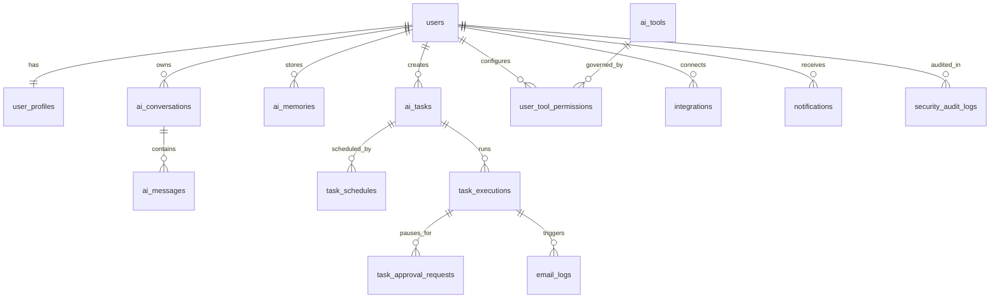

# Multi-Tenant Database Design & Schema Specification

**Database Engine**: PostgreSQL 16 + `pgvector` (`v0.7+`) + `pgcrypto`  
**Migration Tool**: Flyway (`backend-core/src/main/resources/db/migration/`)  
**Isolation Principle**: Strict `user_id` ownership on every personal table + PostgreSQL Row-Level Security (RLS) policies.

---

## 1. Entity Relationship Diagram (ERD)



---

## 2. Complete Table Specifications (16 Core Tables)

### 2.1. Identity & Profile (`users`, `user_profiles`)

```sql
CREATE EXTENSION IF NOT EXISTS "uuid-ossp";
CREATE EXTENSION IF NOT EXISTS "pgcrypto";
CREATE EXTENSION IF NOT EXISTS "vector";

CREATE TABLE users (
    id UUID PRIMARY KEY DEFAULT gen_random_uuid(),
    email VARCHAR(255) NOT NULL UNIQUE,
    password_hash VARCHAR(255) NOT NULL,
    email_verified BOOLEAN NOT NULL DEFAULT FALSE,
    status VARCHAR(32) NOT NULL DEFAULT 'ACTIVE', -- ACTIVE, SUSPENDED, DELETED
    token_version INTEGER NOT NULL DEFAULT 1,     -- Incremented on Kill Switch / logout-all
    daily_token_quota INTEGER NOT NULL DEFAULT 150000,
    daily_tokens_used INTEGER NOT NULL DEFAULT 0,
    quota_reset_at TIMESTAMPTZ NOT NULL DEFAULT NOW(),
    created_at TIMESTAMPTZ NOT NULL DEFAULT NOW(),
    updated_at TIMESTAMPTZ NOT NULL DEFAULT NOW()
);

CREATE TABLE user_profiles (
    user_id UUID PRIMARY KEY REFERENCES users(id) ON DELETE CASCADE,
    display_name VARCHAR(120) NOT NULL,
    persona_type VARCHAR(64) NOT NULL DEFAULT 'GENERAL', -- STUDENT, OFFICE, DEV, BUSINESS, SHOPPER, CREATOR, JOB_SEEKER, GENERAL
    timezone VARCHAR(64) NOT NULL DEFAULT 'Asia/Ho_Chi_Minh',
    locale VARCHAR(16) NOT NULL DEFAULT 'vi-VN',
    notification_email VARCHAR(255),
    preferred_channels JSONB NOT NULL DEFAULT '["IN_APP", "WEB_PUSH"]'::jsonb,
    memory_enabled BOOLEAN NOT NULL DEFAULT TRUE,
    quiet_hours_start TIME, -- e.g. 22:30
    quiet_hours_end TIME,   -- e.g. 06:30
    updated_at TIMESTAMPTZ NOT NULL DEFAULT NOW()
);
```

### 2.2. Conversations & Messages (`ai_conversations`, `ai_messages`)

```sql
CREATE TABLE ai_conversations (
    id UUID PRIMARY KEY DEFAULT gen_random_uuid(),
    user_id UUID NOT NULL REFERENCES users(id) ON DELETE CASCADE,
    title VARCHAR(255) NOT NULL,
    agent_id UUID,
    is_pinned BOOLEAN NOT NULL DEFAULT FALSE,
    is_archived BOOLEAN NOT NULL DEFAULT FALSE,
    last_message_at TIMESTAMPTZ NOT NULL DEFAULT NOW(),
    created_at TIMESTAMPTZ NOT NULL DEFAULT NOW()
);
CREATE INDEX idx_conversations_user_last_msg ON ai_conversations(user_id, last_message_at DESC);

CREATE TABLE ai_messages (
    id UUID PRIMARY KEY DEFAULT gen_random_uuid(),
    conversation_id UUID NOT NULL REFERENCES ai_conversations(id) ON DELETE CASCADE,
    user_id UUID NOT NULL REFERENCES users(id) ON DELETE CASCADE,
    role VARCHAR(24) NOT NULL, -- USER, ASSISTANT, TOOL, SYSTEM
    content TEXT NOT NULL,
    model_used VARCHAR(64),
    prompt_tokens INTEGER DEFAULT 0,
    completion_tokens INTEGER DEFAULT 0,
    citations JSONB NOT NULL DEFAULT '[]'::jsonb, -- Verified URLs & titles
    tool_calls JSONB NOT NULL DEFAULT '[]'::jsonb,
    created_at TIMESTAMPTZ NOT NULL DEFAULT NOW()
);
CREATE INDEX idx_messages_conv_created ON ai_messages(conversation_id, created_at ASC);
CREATE INDEX idx_messages_user_id ON ai_messages(user_id);
```

### 2.3. Personal Memory with `pgvector` (`ai_memories`)

```sql
CREATE TABLE ai_memories (
    id UUID PRIMARY KEY DEFAULT gen_random_uuid(),
    user_id UUID NOT NULL REFERENCES users(id) ON DELETE CASCADE,
    category VARCHAR(48) NOT NULL, -- PREFERENCE, GOAL, FACT, WORK_CONTEXT, REMINDER
    topic_key VARCHAR(120),        -- Used to supersede conflicting facts (e.g., 'target_job_role')
    content TEXT NOT NULL,
    embedding vector(768),         -- text-embedding-004 (768d) or configurable dimension
    status VARCHAR(24) NOT NULL DEFAULT 'ACTIVE', -- CANDIDATE, ACTIVE, SUPERSEDED, DELETED
    confidence NUMERIC(3,2) NOT NULL DEFAULT 1.00,
    source_message_id UUID REFERENCES ai_messages(id) ON DELETE SET NULL,
    expires_at TIMESTAMPTZ,
    created_at TIMESTAMPTZ NOT NULL DEFAULT NOW(),
    updated_at TIMESTAMPTZ NOT NULL DEFAULT NOW()
);
CREATE INDEX idx_memories_user_status ON ai_memories(user_id, status);
CREATE INDEX idx_memories_embedding_hnsw ON ai_memories USING hnsw (embedding vector_cosine_ops);
```

### 2.4. Custom Tasks, Schedules & Idempotent Executions (`ai_tasks`, `task_schedules`, `task_executions`)

```sql
CREATE TABLE ai_tasks (
    id UUID PRIMARY KEY DEFAULT gen_random_uuid(),
    user_id UUID NOT NULL REFERENCES users(id) ON DELETE CASCADE,
    title VARCHAR(200) NOT NULL,
    natural_language_prompt TEXT NOT NULL,
    task_type VARCHAR(48) NOT NULL, -- RESEARCH_MONITOR, DIGEST_REPORT, REMINDER, CUSTOM_WORKFLOW
    structured_config JSONB NOT NULL, -- Search queries, filters, domains, output format
    allowed_tools JSONB NOT NULL DEFAULT '[]'::jsonb,
    delivery_mode VARCHAR(24) NOT NULL DEFAULT 'DELTA_ONLY', -- DELTA_ONLY, ALWAYS_SEND
    delivery_channels JSONB NOT NULL DEFAULT '["IN_APP", "EMAIL", "WEB_PUSH"]'::jsonb,
    status VARCHAR(32) NOT NULL DEFAULT 'ACTIVE', -- DRAFT, ACTIVE, PAUSED, PAUSED_BY_KILL_SWITCH, ARCHIVED
    created_at TIMESTAMPTZ NOT NULL DEFAULT NOW(),
    updated_at TIMESTAMPTZ NOT NULL DEFAULT NOW()
);
CREATE INDEX idx_tasks_user_status ON ai_tasks(user_id, status);

CREATE TABLE task_schedules (
    id UUID PRIMARY KEY DEFAULT gen_random_uuid(),
    task_id UUID NOT NULL REFERENCES ai_tasks(id) ON DELETE CASCADE,
    user_id UUID NOT NULL REFERENCES users(id) ON DELETE CASCADE,
    cron_expression VARCHAR(64) NOT NULL, -- e.g. '0 0 8 * * *'
    timezone VARCHAR(64) NOT NULL DEFAULT 'Asia/Ho_Chi_Minh',
    misfire_policy VARCHAR(32) NOT NULL DEFAULT 'FIRE_ONCE_WITHIN_WINDOW',
    next_run_at TIMESTAMPTZ NOT NULL,
    last_run_at TIMESTAMPTZ,
    is_enabled BOOLEAN NOT NULL DEFAULT TRUE,
    created_at TIMESTAMPTZ NOT NULL DEFAULT NOW()
);
CREATE INDEX idx_schedules_next_run ON task_schedules(next_run_at ASC) WHERE is_enabled = TRUE;

CREATE TABLE task_executions (
    id UUID PRIMARY KEY DEFAULT gen_random_uuid(),
    task_id UUID NOT NULL REFERENCES ai_tasks(id) ON DELETE CASCADE,
    user_id UUID NOT NULL REFERENCES users(id) ON DELETE CASCADE,
    idempotency_key VARCHAR(128) NOT NULL, -- SHA256(task_id + scheduled_slot_utc)
    trigger_type VARCHAR(24) NOT NULL DEFAULT 'SCHEDULED', -- SCHEDULED, MANUAL_RUN, RETRY
    status VARCHAR(32) NOT NULL DEFAULT 'QUEUED',
    -- QUEUED, RUNNING, WAITING_FOR_APPROVAL, COMPLETED, COMPLETED_NO_DELTA, FAILED_RETRYABLE, FAILED_FINAL, CANCELLED
    attempt_count INTEGER NOT NULL DEFAULT 1,
    step_checkpoints JSONB NOT NULL DEFAULT '{}'::jsonb,
    result_summary TEXT,
    result_items JSONB NOT NULL DEFAULT '[]'::jsonb,
    content_fingerprints JSONB NOT NULL DEFAULT '[]'::jsonb, -- Array of SHA256 item hashes for Delta deduplication
    verified_citations JSONB NOT NULL DEFAULT '[]'::jsonb,
    tokens_consumed INTEGER NOT NULL DEFAULT 0,
    error_code VARCHAR(64),
    error_message TEXT,
    started_at TIMESTAMPTZ NOT NULL DEFAULT NOW(),
    completed_at TIMESTAMPTZ,
    CONSTRAINT uq_task_execution_idempotency UNIQUE (task_id, idempotency_key)
);
CREATE INDEX idx_executions_user_started ON task_executions(user_id, started_at DESC);
CREATE INDEX idx_executions_task_status ON task_executions(task_id, status);
```

### 2.5. Agents, Tools, 4-Level Permissions & HITL Approvals (`ai_agents`, `ai_tools`, `user_tool_permissions`, `task_approval_requests`)

```sql
CREATE TABLE ai_agents (
    id UUID PRIMARY KEY DEFAULT gen_random_uuid(),
    code VARCHAR(64) NOT NULL UNIQUE, -- RESEARCH_AGENT, LIFE_ADMIN_AGENT, DOC_ANALYST_AGENT
    name VARCHAR(120) NOT NULL,
    description TEXT NOT NULL,
    default_model_tier VARCHAR(32) NOT NULL DEFAULT 'FAST',
    system_prompt_template TEXT NOT NULL,
    allowed_tool_codes JSONB NOT NULL DEFAULT '[]'::jsonb,
    is_active BOOLEAN NOT NULL DEFAULT TRUE,
    created_at TIMESTAMPTZ NOT NULL DEFAULT NOW()
);

CREATE TABLE ai_tools (
    id UUID PRIMARY KEY DEFAULT gen_random_uuid(),
    code VARCHAR(64) NOT NULL UNIQUE, -- searxng_search, rss_fetch, doc_parse, email_send, calendar_write
    name VARCHAR(120) NOT NULL,
    category VARCHAR(48) NOT NULL,    -- RESEARCH, EMAIL, CALENDAR, DOCUMENT, TRANSLATION, VISION, NOTIFICATION
    permission_level SMALLINT NOT NULL CHECK (permission_level BETWEEN 1 AND 4),
    -- 1: READ_ONLY, 2: LIMITED_ACTION, 3: APPROVAL_REQUIRED, 4: RESTRICTED
    input_schema JSONB NOT NULL,
    timeout_seconds INTEGER NOT NULL DEFAULT 15,
    rate_limit_per_hour INTEGER NOT NULL DEFAULT 60,
    is_enabled_globally BOOLEAN NOT NULL DEFAULT TRUE,
    version VARCHAR(24) NOT NULL DEFAULT '1.0.0'
);

CREATE TABLE user_tool_permissions (
    id UUID PRIMARY KEY DEFAULT gen_random_uuid(),
    user_id UUID NOT NULL REFERENCES users(id) ON DELETE CASCADE,
    tool_id UUID NOT NULL REFERENCES ai_tools(id) ON DELETE CASCADE,
    policy_override VARCHAR(24) NOT NULL DEFAULT 'DEFAULT', -- ALLOW, REQUIRE_APPROVAL, DENY, DEFAULT
    daily_call_limit INTEGER NOT NULL DEFAULT 100,
    updated_at TIMESTAMPTZ NOT NULL DEFAULT NOW(),
    CONSTRAINT uq_user_tool UNIQUE (user_id, tool_id)
);

CREATE TABLE task_approval_requests (
    id UUID PRIMARY KEY DEFAULT gen_random_uuid(),
    execution_id UUID NOT NULL REFERENCES task_executions(id) ON DELETE CASCADE,
    user_id UUID NOT NULL REFERENCES users(id) ON DELETE CASCADE,
    tool_code VARCHAR(64) NOT NULL,
    proposed_payload JSONB NOT NULL, -- Exact email recipient/subject/body or calendar event to review
    langgraph_checkpoint JSONB NOT NULL, -- Serialized state to resume execution
    status VARCHAR(24) NOT NULL DEFAULT 'PENDING', -- PENDING, APPROVED, REJECTED, EXPIRED
    expires_at TIMESTAMPTZ NOT NULL,
    decided_at TIMESTAMPTZ,
    created_at TIMESTAMPTZ NOT NULL DEFAULT NOW()
);
CREATE INDEX idx_approvals_user_pending ON task_approval_requests(user_id, status) WHERE status = 'PENDING';
```

### 2.6. Notifications, Email Logs, Integrations & Security Audit (`notifications`, `email_logs`, `integrations`, `security_audit_logs`)

```sql
CREATE TABLE notifications (
    id UUID PRIMARY KEY DEFAULT gen_random_uuid(),
    user_id UUID NOT NULL REFERENCES users(id) ON DELETE CASCADE,
    execution_id UUID REFERENCES task_executions(id) ON DELETE SET NULL,
    type VARCHAR(32) NOT NULL, -- TASK_RESULT, APPROVAL_NEEDED, SECURITY_ALERT, SYSTEM
    title VARCHAR(200) NOT NULL,
    body TEXT NOT NULL,
    action_url VARCHAR(255),
    is_read BOOLEAN NOT NULL DEFAULT FALSE,
    web_push_sent BOOLEAN NOT NULL DEFAULT FALSE,
    created_at TIMESTAMPTZ NOT NULL DEFAULT NOW()
);
CREATE INDEX idx_notifications_user_unread ON notifications(user_id, is_read, created_at DESC);

CREATE TABLE email_logs (
    id UUID PRIMARY KEY DEFAULT gen_random_uuid(),
    user_id UUID NOT NULL REFERENCES users(id) ON DELETE CASCADE,
    execution_id UUID REFERENCES task_executions(id) ON DELETE SET NULL,
    recipient_email VARCHAR(255) NOT NULL,
    subject VARCHAR(255) NOT NULL,
    provider_message_id VARCHAR(128),
    status VARCHAR(24) NOT NULL, -- QUEUED, SENT, BOUNCED, FAILED
    error_detail TEXT,
    sent_at TIMESTAMPTZ NOT NULL DEFAULT NOW(),
    CONSTRAINT uq_email_per_execution UNIQUE (execution_id, recipient_email)
);

CREATE TABLE integrations (
    id UUID PRIMARY KEY DEFAULT gen_random_uuid(),
    user_id UUID NOT NULL REFERENCES users(id) ON DELETE CASCADE,
    provider VARCHAR(48) NOT NULL, -- WEB_PUSH_SUBSCRIPTION, GOOGLE_CALENDAR, CUSTOM_RSS
    encrypted_credentials BYTEA NOT NULL, -- AES-256-GCM encrypted token/subscription payload
    key_version SMALLINT NOT NULL DEFAULT 1,
    scopes JSONB NOT NULL DEFAULT '[]'::jsonb,
    status VARCHAR(24) NOT NULL DEFAULT 'ACTIVE', -- ACTIVE, REVOKED, EXPIRED
    created_at TIMESTAMPTZ NOT NULL DEFAULT NOW(),
    updated_at TIMESTAMPTZ NOT NULL DEFAULT NOW()
);

CREATE TABLE security_audit_logs (
    id UUID PRIMARY KEY DEFAULT gen_random_uuid(),
    user_id UUID, -- Uncoupled UUID so REQUIRES_NEW audit transactions commit independently & survive account deletion
    event_type VARCHAR(64) NOT NULL,
    -- LOGIN_SUCCESS, LOGIN_FAILED, TOKEN_REUSE_DETECTED, TOOL_DENIED_LEVEL4, PROMPT_INJECTION_BLOCKED, KILL_SWITCH_ACTIVATED
    severity VARCHAR(16) NOT NULL DEFAULT 'INFO', -- INFO, WARN, HIGH, CRITICAL
    ip_address VARCHAR(64),
    user_agent TEXT,
    resource_type VARCHAR(48),
    resource_id VARCHAR(64),
    metadata JSONB NOT NULL DEFAULT '{}'::jsonb,
    created_at TIMESTAMPTZ NOT NULL DEFAULT NOW()
);
CREATE INDEX idx_audit_user_created ON security_audit_logs(user_id, created_at DESC);
CREATE INDEX idx_audit_severity_created ON security_audit_logs(severity, created_at DESC);
```

---

## 3. Defense-in-Depth Database Controls

1. **Application-Layer Ownership Enforcement**: Every Spring Data JPA query includes `user_id` bound from the authenticated `SecurityContext`.
2. **PostgreSQL Row-Level Security (RLS) Policy**:
   ```sql
   ALTER TABLE ai_tasks ENABLE ROW LEVEL SECURITY;
   CREATE POLICY tenant_isolation_ai_tasks ON ai_tasks
       USING (user_id = current_setting('app.current_user_id', true)::uuid);
   ```
3. **Envelope Encryption for `integrations.encrypted_credentials`**: OAuth tokens and Web Push VAPID keys are encrypted using `AES-256-GCM` with a server-managed Master Key (`APP_ENCRYPTION_MASTER_KEY`) before writing to PostgreSQL.

