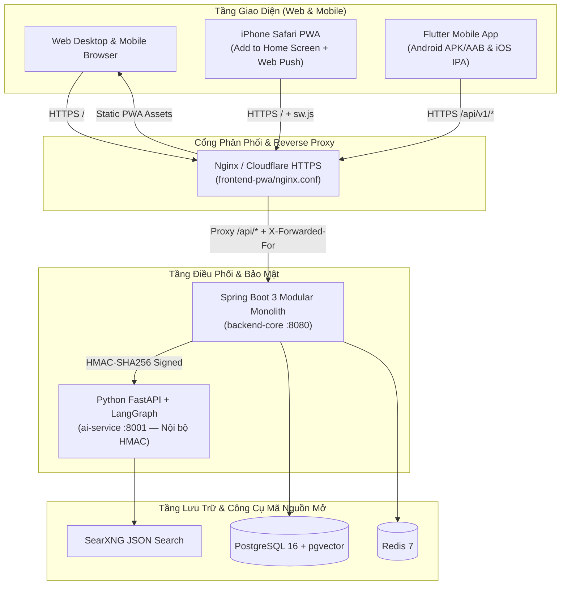

# Hướng Dẫn Triển Khai (Deployment Guide) — Web, iPhone Safari PWA & Mobile Flutter

Tài liệu này hướng dẫn cách đóng gói và triển khai toàn bộ hệ thống **AI Life Assistant Platform (AIFP)** để hoạt động mượt mà trên cả **Web Desktop**, **iPhone Safari PWA (Add to Home Screen)**, và **Ứng dụng Mobile Native (Flutter iOS / Android)**.

---

## 1. Kiến Trúc Triển Khai Hợp Nhất (Web & Mobile Dùng Chung 1 Cổng API)



---

## 2. Triển Khai Toàn Hệ Thống Bằng 1 Lệnh Docker Compose (VPS / Cloud)

Toàn bộ 7 dịch vụ (`postgres`, `redis`, `searxng`, `minio`, `ai-service`, `backend-core`, `frontend-pwa`) đã được đóng gói sẵn trong [`infra/docker-compose.yml`](../infra/docker-compose.yml) cùng các multi-stage `Dockerfile`:
- [`backend-core/Dockerfile`](../backend-core/Dockerfile)
- [`ai-service/Dockerfile`](../ai-service/Dockerfile)
- [`frontend-pwa/Dockerfile`](../frontend-pwa/Dockerfile) & [`frontend-pwa/nginx.conf`](../frontend-pwa/nginx.conf)

### Bước 1: Tạo file `.env` từ `.env.example`
```bash
cp .env.example .env
# Cập nhật JWT_SIGNING_SECRET, INTERNAL_SHARED_SECRET, POSTGRES_PASSWORD cho môi trường Production
```

### Bước 2: Khởi chạy toàn bộ Stack
```bash
docker compose -f infra/docker-compose.yml up -d --build
```
- **Web App & iPhone PWA**: Truy cập tại `http://<IP-hoặc-Domain>` (hoặc qua Cloudflare Tunnel / HTTPS Reverse Proxy).
- **Health Check Backend**: `http://<IP-hoặc-Domain>/api/v1/health` -> trả về `{"success":true,"data":{"status":"UP"}}`.

---

## 3. Tối Ưu Hóa Khi Dùng Trên iPhone Safari PWA

Để trải nghiệm trên **iPhone (iOS 16.4+)** mượt như ứng dụng bản địa và nhận được thông báo Web Push lúc 08:00 sáng:

1. **Yêu cầu HTTPS (hoặc Localhost)**: Service Worker ([`frontend-pwa/public/sw.js`](../frontend-pwa/public/sw.js)) và Web Push API của Apple bắt buộc chạy trên `https://`.
2. **Chống kẹt bộ nhớ đệm Service Worker trên iOS**:
   - File [`frontend-pwa/nginx.conf`](../frontend-pwa/nginx.conf) đã cấu hình `Cache-Control: no-cache, no-store, must-revalidate` riêng cho `/sw.js` và `/manifest.webmanifest` để mỗi lần bạn cập nhật giao diện Web, iPhone sẽ nhận bản mới ngay lập tức.
3. **Thao tác cài đặt trên iPhone**:
   - Mở địa chỉ Web trên **Safari** -> Nhấn nút **Chia sẻ (Share)** -> Chọn **Thêm vào Màn hình chính (Add to Home Screen)**.
   - Giao diện sử dụng `100dvh` và `env(safe-area-inset-bottom)` trong [`frontend-pwa/src/styles/tokens.css`](../frontend-pwa/src/styles/tokens.css) nên không bị che bởi thanh Home Indicator hay tai thỏ (Dynamic Island).

---

## 4. Đóng Gói & Triển Khai Ứng Dụng Mobile Flutter (`mobile-flutter`)

Ứng dụng [`mobile-flutter/lib/main.dart`](../mobile-flutter/lib/main.dart) sử dụng `String.fromEnvironment('API_BASE_URL')` (không chứa bất kỳ khóa bí mật nào trong mã nguồn ứng dụng):

### Build Android (`APK` / `App Bundle`)
```bash
cd mobile-flutter
flutter build apk --release --dart-define=API_BASE_URL=https://api.ten-mien-cua-ban.com
```

### Build iOS (`IPA` / TestFlight trên macOS)
```bash
cd mobile-flutter
flutter build ipa --release --dart-define=API_BASE_URL=https://api.ten-mien-cua-ban.com
```

### Chạy thử trực tiếp trên Điện thoại thật qua mạng Wi-Fi nội bộ (LAN)
1. Chạy Backend (`mvn spring-boot:run` ở cổng `8080`) và Web (`npm run dev` ở cổng `5173` — đã bật `host: true` trong [`frontend-pwa/vite.config.ts`](../frontend-pwa/vite.config.ts)).
2. Trên iPhone / Android cùng mạng Wi-Fi, mở `http://<IP-LAN-Máy-Tính>:5173` hoặc truyền `--dart-define=API_BASE_URL=http://<IP-LAN-Máy-Tính>:8080` khi chạy Flutter.
3. Cấu hình CORS trong [`SecurityConfig.java`](../backend-core/src/main/java/com/aifp/core/security/SecurityConfig.java) đã hỗ trợ tự động dải `http://192.168.*:*`, `http://10.0.2.2:*` (Android Emulator) và `https://*`.

