# Hướng Dẫn Chi Tiết Cấu Hình File `.env` & Lấy API Key — AIFP

> **Tài liệu hướng dẫn**: AI Life Assistant Platform (`AIFP`)  
> **Áp dụng cho**: Cả môi trường chạy thử nghiệm cục bộ (Local Dev) và máy chủ sản xuất (Production VPS / Cloud).

---

## 1. Tổng quan về File `.env`

File `.env` nằm tại thư mục gốc của dự án (`c:\ANew\AIFP\.env`). File này chứa toàn bộ thông tin nhạy cảm của hệ thống:
1. **Kết nối Cơ sở dữ liệu (PostgreSQL + Redis)**: Cục bộ Docker hoặc Cloud Supabase/Neon.
2. **Khóa mật mã hệ thống (JWT, HMAC, AES-256)**: Bảo vệ phiên đăng nhập và mã hóa dữ liệu.
3. **Kho API Key AI Đa Tầng**: Tự động xoay vòng nhiều key và tự động chuyển đổi qua Groq/OpenRouter khi hết hạn mức (Quota/Rate Limit 429).

> [!NOTE]
> File `.env` chứa mật khẩu thực tế nên **không bao giờ được đẩy (push) lên Git công khai**. Dự án đã có sẵn file mẫu [`.env.example`](../.env.example) để tham khảo.

---

## 2. Hướng dẫn lấy các API Key AI (Chi Tiết Từng Bước)

Hệ thống AIFP được tích hợp sẵn bộ định tuyến thông minh **5 tầng dự phòng** (`MultiProviderFailoverRouter`). Bạn chỉ cần tối thiểu **1 key Google Gemini** là hệ thống đã hoạt động mượt mà. Nếu bạn gắn thêm key Groq hoặc OpenRouter, hệ thống sẽ tự động chuyển đổi khi hết token.

```mermaid
flowchart TD
    UserReq["Yêu cầu AI từ Người dùng"] --> GeminiPool["Tầng 1: Google Gemini (Hỗ trợ Multi-Key)"]
    GeminiPool -->|Hết Quota Key 1| GeminiKey2["Đổi sang Key 2 / Key 3"]
    GeminiKey2 -->|Hết Quota Pro| GeminiFlash["Hạ cấp xuống 2.5-Flash / 2.0-Flash"]
    GeminiFlash -->|Gặp lỗi 429 Rate Limit| GroqPool["Tầng 2: Groq Cloud (Free LPU)"]
    GroqPool -->|Llama 3.3 70B siêu tốc| Success1["Trả lời kết quả"]
    GroqPool -->|Hết Quota Groq| OpenRouterPool["Tầng 3: OpenRouter Free Pool"]
    OpenRouterPool -->|DeepSeek / Llama Free| Success2["Trả lời kết quả"]
    OpenRouterPool -->|Hết Quota Free| OpenAIPool["Tầng 4: OpenAI GPT (Có phí dự phòng)"]
    OpenAIPool -->|Mất mạng / Hết sạch token| OllamaLocal["Tầng 5: Ollama Offline Local"]
```



---

### 2.1. Google Gemini API Key (Ưu tiên số 1 — Miễn phí)

- **Chi phí**: **0 VNĐ** (Google cấp miễn phí hạn mức rất hào phóng cho nhà phát triển).
- **Các model hỗ trợ**: `gemini-2.5-pro` (suy luận sâu), `gemini-2.5-flash` (mặc định siêu nhanh), `gemini-2.0-flash`, `gemini-2.0-flash-lite`.

#### Các bước lấy Key:
1. Mở trình duyệt và truy cập: [https://aistudio.google.com/app/apikey](https://aistudio.google.com/app/apikey).
2. Đăng nhập bằng tài khoản Google (Gmail) của bạn.
3. Bấm nút **Create API key** (Tạo khóa API).
4. Chọn một dự án Google Cloud có sẵn (hoặc chọn *Create key in new project*).
5. Copy chuỗi khóa có dạng: `AIzaSy...`.

#### Mẹo gắn nhiều key tránh hết Quota:
Nếu bạn dùng nhiều tài khoản Google hoặc tạo nhiều key, hãy dán chúng vào file `.env`, cách nhau bởi **dấu phẩy**:
```env
GEMINI_API_KEYS=AIzaSyKeyThuNhat...,AIzaSyKeyThuHai...,AIzaSyKeyThuBa...
```
*Khi Key thứ nhất gặp lỗi 429 quá tải, hệ thống sẽ tự động chuyển sang Key thứ hai ngay lập tức mà không làm gián đoạn người dùng.*

---

### 2.2. Groq Cloud API Key (Dự phòng số 1 — Miễn phí, Siêu tốc)

- **Chi phí**: **0 VNĐ** (Cực kỳ khuyến khích đăng ký).
- **Tốc độ**: Siêu nhanh (~500 tokens/giây nhờ chip LPU).
- **Model**: `llama-3.3-70b-versatile` (chất lượng tương đương GPT-4) và `llama-3.1-8b-instant`.

#### Các bước lấy Key:
1. Truy cập: [https://console.groq.com/keys](https://console.groq.com/keys).
2. Đăng ký tài khoản (bằng Google hoặc GitHub miễn phí).
3. Tại trang API Keys, bấm **Create API Key**.
4. Đặt tên (ví dụ: `AIFP_Groq`) rồi bấm **Submit**.
5. Copy chuỗi khóa có dạng: `gsk_...`.
6. Dán vào file `.env`:
   ```env
   GROQ_API_KEYS=gsk_...
   ```

---

### 2.3. OpenRouter API Key (Kho Model Miễn Phí Mở Rộng)

- **Chi phí**: Có sẵn gói **Free** tổng hợp hàng chục model mã nguồn mở hàng đầu.
- **Model**: `deepseek/deepseek-chat:free`, `meta-llama/llama-3.3-70b-instruct:free`, `google/gemini-2.0-flash-exp:free`.

#### Các bước lấy Key:
1. Truy cập: [https://openrouter.ai/keys](https://openrouter.ai/keys).
2. Đăng nhập bằng tài khoản Google.
3. Bấm **Create Key**.
4. Copy chuỗi khóa có dạng: `sk-or-v1-...`.
5. Dán vào file `.env`:
   ```env
   OPENROUTER_API_KEYS=sk-or-v1-...
   ```

---

### 2.4. OpenAI API Key (Tùy chọn — Dự phòng thương mại có phí)

- Nếu bạn đã có tài khoản OpenAI trả phí và muốn dùng GPT-4o / GPT-4o-mini làm tầng dự phòng thứ 4:
1. Truy cập: [https://platform.openai.com/api-keys](https://platform.openai.com/api-keys).
2. Bấm **Create new secret key**.
3. Copy chuỗi khóa có dạng: `sk-proj-...`.
4. Dán vào file `.env`:
   ```env
   OPENAI_API_KEYS=sk-proj-...
   ```
*(Nếu không dùng, bạn có thể để trống dòng này).*

---

### 2.5. Ollama Local (Tùy chọn — Chạy Offline trên máy)

- Dành cho trường hợp máy chủ mất kết nối Internet hoặc toàn bộ các key bên trên đều hết token:
- Cài đặt Ollama từ [https://ollama.com](https://ollama.com) và tải model:
  ```bash
  ollama run qwen2.5:7b
  ```
- Cấu hình trong `.env`:
  ```env
  OLLAMA_BASE_URL=http://localhost:11434
  ```

---

## 3. Tạo các mã bảo mật hệ thống (JWT, HMAC, AES)

Hệ thống AIFP yêu cầu 3 chuỗi bí mật để đảm bảo an toàn cấp ngân hàng:
- `JWT_SIGNING_SECRET`: Ký xác thực Token đăng nhập của người dùng.
- `INTERNAL_SHARED_SECRET`: Xác thực liên lạc ngầm giữa Spring Boot (8080) và Python AI Service (8001).
- `AES_MASTER_KEY`: Mã hóa AES-256-GCM các API key cá nhân của người dùng trong cơ sở dữ liệu.

> [!TIP]
> **Trong file `.env` đã tạo sẵn cho bạn tại thư mục gốc, 3 chuỗi khóa này ĐÃ ĐƯỢC TỰ ĐỘNG SINH AN TOÀN**. Bạn không bắt buộc phải sinh lại nếu không muốn.

Nếu bạn muốn tự tạo lại chuỗi ngẫu nhiên mới bất kỳ lúc nào:

### Trên Windows (PowerShell):
Mở PowerShell và dán 1 dòng lệnh sau:
```powershell
python -c "import secrets; print('JWT=' + secrets.token_hex(32)); print('HMAC=' + secrets.token_hex(32)); print('AES=' + secrets.token_hex(32))"
```

### Hoặc bằng lệnh OpenSSL (Linux / Mac / Git Bash):
```bash
openssl rand -hex 32
```

---

## 4. Cấu hình Cơ sở dữ liệu: Local VPS vs Cloud Managed

| Hướng đi | Phương án A: Tự host Local trên VPS (Mã nguồn mở) | Phương án B: Cloud Managed Database (Bán SaaS) |
| :--- | :--- | :--- |
| **Mục đích** | Tự dùng cá nhân, phát hành Free mã nguồn mở | Bán phần mềm dịch vụ (SaaS) cho người dùng bên ngoài |
| **Chi phí** | **0 VNĐ thêm** (chỉ tốn tiền VPS $5/tháng) | Miễn phí ban đầu (500MB), sau đó trả theo dung lượng |
| **Ưu điểm** | Dữ liệu riêng tư 100%, không phụ thuộc bên thứ 3 | Tự động sao lưu (backup) hằng ngày, không lo hỏng ổ cứng VPS |
| **Nền tảng** | Chạy sẵn qua `docker compose` của dự án | [Supabase](https://supabase.com) hoặc [Neon.tech](https://neon.tech) |

### Cách cấu hình trong `.env`:

#### Nếu chọn Phương án A (Local VPS qua Docker Compose - Mặc định):
Giữ nguyên như sau:
```env
POSTGRES_HOST=postgres
POSTGRES_PORT=5432
POSTGRES_DB=aifp_db
POSTGRES_USER=aifp_user
POSTGRES_PASSWORD=AifpLocalDbPass#2026
```

#### Nếu chọn Phương án B (Cloud Supabase / Neon):
1. Vào [Supabase](https://supabase.com), bấm **New Project**.
2. Bật extension `vector` trong mục **Database -> Extensions**.
3. Vào **Settings -> Database**, lấy thông tin kết nối và dán vào `.env`:
```env
POSTGRES_HOST=aws-0-ap-southeast-1.pooler.supabase.com
POSTGRES_PORT=5432
POSTGRES_DB=postgres
POSTGRES_USER=postgres.your_project_id
POSTGRES_PASSWORD=MatKhauSupabaseCuaBan
```
*(Spring Boot Modular Monolith sẽ tự động kích hoạt Flyway chạy toàn bộ 6 file migration tạo 20 bảng cơ sở dữ liệu lên Supabase mà không cần viết lệnh SQL thủ công).*

---

## 5. Mẫu File `.env` Hoàn Chỉnh

Dưới đây là nội dung mẫu file `.env` chuẩn đã sẵn sàng:

```env
# ============================================================================
# AI Life Assistant Platform (AIFP) — Production & Local Environment Config
# ============================================================================

# ----------------------------------------------------------------------------
# 1. CƠ SỞ DỮ LIỆU POSTGRESQL + PGVECTOR & REDIS
# ----------------------------------------------------------------------------
POSTGRES_HOST=postgres
POSTGRES_PORT=5432
POSTGRES_DB=aifp_db
POSTGRES_USER=aifp_user
POSTGRES_PASSWORD=AifpLocalDbPass#2026

REDIS_HOST=redis
REDIS_PORT=6379

# ----------------------------------------------------------------------------
# 2. KHÓA BẢO MẬT HỆ THỐNG
# ----------------------------------------------------------------------------
JWT_SIGNING_SECRET=99c89c2889a8c735637b6f65d32d86bb8d4e42fe513aadab718f9d16e1093c1f
INTERNAL_SHARED_SECRET=f0c4fe55767695bc3db581a553d7c7f4ce67408a902e680cdbfde24559051392
AES_MASTER_KEY=c04e09d47d0e52d43694ff6188e4e6ea084734adec0e7a3e4ee9a4eef401206b

# ----------------------------------------------------------------------------
# 3. KHO API KEY AI ĐA TẦNG (TỰ ĐỘNG CHUYỂN ĐỔI KHI HẾT TOKEN)
# ----------------------------------------------------------------------------
# Dán 1 hoặc nhiều key Gemini cách nhau bằng dấu phẩy
GEMINI_API_KEYS=

# Dán key Groq Cloud miễn phí
GROQ_API_KEYS=

# Dán key OpenRouter miễn phí
OPENROUTER_API_KEYS=

# Dán key OpenAI có phí (tùy chọn)
OPENAI_API_KEYS=

# URL Ollama offline cục bộ
OLLAMA_BASE_URL=http://localhost:11434

# ----------------------------------------------------------------------------
# 4. CẤU HÌNH CỔNG VÀ MẠNG NỘI BỘ
# ----------------------------------------------------------------------------
BACKEND_PORT=8080
AI_SERVICE_PORT=8001
WEB_PORT=80
CORS_ALLOWED_ORIGIN_PATTERNS=http://localhost:*,http://127.0.0.1:*,http://10.0.2.2:*,http://192.168.*:*,https://*
```

---

## 6. Các Lệnh Khởi Chạy Sau Khi Gắn Key

### Lựa chọn 1: Chạy trọn gói bằng Docker Compose (Khuyên dùng)
```powershell
docker compose -f infra/docker-compose.yml up --build -d
```
- Web PWA & Safari App: [http://localhost:80](http://localhost:80)
- Backend Core API: [http://localhost:8080/api/v1/health](http://localhost:8080/api/v1/health)
- AI Service LangGraph: [http://localhost:8001/health](http://localhost:8001/health)
- SearXNG Search Engine: [http://localhost:8088](http://localhost:8088)

### Lựa chọn 2: Chạy trực tiếp từng service (Chế độ Lập trình Dev)
- **Terminal 1 (Python AI)**:
  ```powershell
  cd ai-service
  python -m uvicorn app.main:app --port 8001 --reload
  ```
- **Terminal 2 (Spring Boot Backend)**:
  ```powershell
  cd backend-core
  mvn spring-boot:run
  ```
- **Terminal 3 (React PWA Web)**:
  ```powershell
  cd frontend-pwa
  npm run dev
  ```
- **Terminal 4 (Flutter Mobile Companion)**:
  ```powershell
  cd mobile-flutter
  flutter run
  ```

