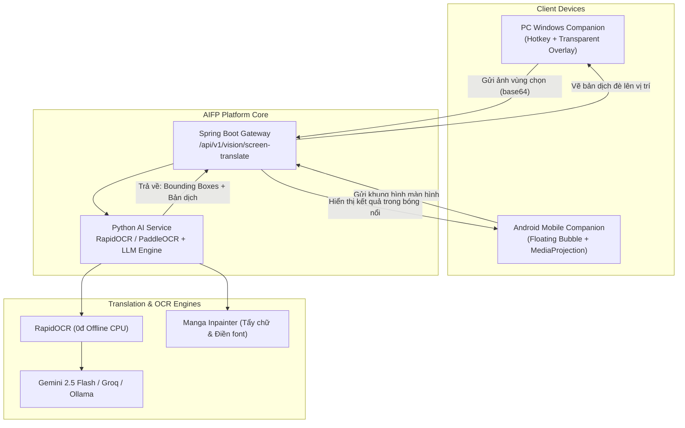

# Screen OCR, Live Translation & Curated Open-Source Radar Spec

> **Persistent Blueprint**: Tài liệu này lưu trữ toàn bộ yêu cầu, kiến trúc kỹ thuật và danh bạ mã nguồn mở được tuyển chọn theo chỉ thị của người dùng. Mọi phiên làm việc tiếp theo của AI Agent đều bắt buộc phải ghi nhớ tài liệu này khi được yêu cầu xây dựng tính năng.

---

## 1. Yêu cầu cốt lõi của Người dùng (User Requirements)

1. **Dịch màn hình trực tiếp theo vùng chọn (Screen Region Translation)**:
   - Cho phép người dùng khoanh vùng bất kỳ trên màn hình PC hoặc Mobile (trong game, truyện tranh, app nước ngoài, phụ đề video).
   - Tự động nhận diện chữ (OCR) và dịch sang tiếng Việt trong thời gian thực.
   - Hiển thị bản dịch dạng **cửa sổ nổi trong suốt (Transparent Overlay)** đè lên đúng vị trí chữ gốc hoặc hiện qua **Bong bóng nổi (Floating Bubble)**.
2. **Hỗ trợ đa nền tảng**:
   - **PC (Windows)**: Điều khiển bằng phím tắt (ví dụ `Ctrl + Alt + T`), kéo chuột chọn vùng, giữ overlay cố định khi chơi game/lướt web.
   - **Mobile (Android)**: Bong bóng nổi luôn chạy trên nền màn hình, chạm để dịch hoặc kéo thả vào đoạn chữ cần dịch.
   - **Mobile (iOS)**: Chụp màn hình và chia sẻ vào Aura qua phím tắt / Action Extension.

---

## 2. Danh bạ Mã Nguồn Mở Tinh Hoa Đã Tuyển Chọn (Curated Open-Source Radar)

### A. Dịch màn hình trực tiếp trên PC (Windows / Games / Subtitles)
- **MORT** ([`kmonkeyhead/MORT`](https://github.com/kmonkeyhead/MORT)):
  - *Đặc điểm*: Dịch game thời gian thực kinh điển trên Windows, chọn vùng tọa độ cố định, hỗ trợ Windows Media OCR, Tesseract, DeepL, Google.
  - *Ứng dụng cho AIFP*: Mô hình mẫu cho cơ chế Transparent Overlay Window và chọn vùng `(x, y, w, h)`.
- **LunaTranslator** ([`HIllya51/LunaTranslator`](https://github.com/HIllya51/LunaTranslator)):
  - *Đặc điểm*: Công cụ dịch game mạnh nhất hiện nay. Hỗ trợ hook text từ bộ nhớ RAM game, OCR PaddleOCR/Windows OCR, kết nối LLM offline/online.
  - *Ứng dụng cho AIFP*: Tham khảo cơ chế text hooking và multi-engine translation.
- **Translumo** ([`ramjke/Translumo`](https://github.com/ramjke/Translumo)):
  - *Đặc điểm*: Dịch phụ đề cứng thời gian thực cho video và game, giao diện hiện đại.

### B. Dịch màn hình & Bong bóng nổi trên Android Mobile
- **ALSTMobile** ([`navidseyedain/ALSTMobile`](https://github.com/navidseyedain/ALSTMobile)):
  - *Đặc điểm*: Ứng dụng Android mã nguồn mở dịch màn hình bằng Gemini Vision và Google ML Kit, vẽ overlay đè lên toạ độ chữ gốc.
- **screen-trans** ([`Tensorlong/screen-trans`](https://github.com/Tensorlong/screen-trans)):
  - *Đặc điểm*: Bong bóng nổi di động trên Android, nhận diện 140+ ngôn ngữ, hỗ trợ dịch offline.
- **overlay-translator** ([`ciddwd/overlay-translator`](https://github.com/ciddwd/overlay-translator)):
  - *Đặc điểm*: Không cần Root, hỗ trợ OCR nội bộ và kết nối LLM chạy cục bộ qua `llama.cpp`.

### C. Dịch & Tẩy xóa chữ thông minh trong truyện tranh/ảnh (Inpainting)
- **manga-image-translator** ([`zyddnys/manga-image-translator`](https://github.com/zyddnys/manga-image-translator)):
  - *Đặc điểm*: Tự động phát hiện khung thoại, tẩy xóa chữ gốc (Inpainting) và điền chữ đã dịch vào đúng font, giữ nguyên hình vẽ như truyện gốc.

### D. Thư viện OCR siêu nhẹ & AI Tự động hóa màn hình (Automation)
- **RapidOCR** ([`RapidAI/RapidOCR`](https://github.com/RapidAI/RapidOCR)):
  - *Đặc điểm*: Thư viện OCR chạy trên CPU siêu tốc độ (<15MB), hỗ trợ tiếng Việt cực chuẩn, không cần GPU, chi phí 0đ.
- **AppAgent** ([`mnotgod96/AppAgent`](https://github.com/mnotgod96/AppAgent)):
  - *Đặc điểm*: AI Agent của Tencent mã nguồn mở: nhìn màn hình điện thoại và tự bấm/lướt thực hiện tác vụ tự động.
- **Screenpipe** ([`mediar-ai/screenpipe`](https://github.com/mediar-ai/screenpipe)):
  - *Đặc điểm*: Tự động ghi lại và phân tích màn hình + âm thanh máy tính 24/7 cục bộ để hỏi đáp ngữ cảnh đã xem.

---

## 3. Kiến trúc tích hợp vào AIFP Platform (Module 18)

---

## 4. Kế hoạch triển khai khi người dùng yêu cầu thực hiện

Khi người dùng ra lệnh *"Làm phần dịch màn hình MORT / Bong bóng nổi"*, AI Agent sẽ tiến hành các bước sau:
1. **Bước 1 (Backend & AI API)**:
   - Thêm endpoint `POST /internal/v1/agent/translate-screen-region` trong `ai-service/app/main.py`.
   - Nhúng `RapidOCR` và prompt chuyên biệt giữ nguyên cấu trúc dòng của bản gốc.
2. **Bước 2 (PC Companion Client)**:
   - Bổ sung module `screen_translator.py` trong client PC Companion (sử dụng thư viện cửa sổ trong suốt `PyQt6` hoặc `tkinter` + `mss` chụp màn hình).
   - Thiết lập phím tắt `Ctrl + Shift + T` để khoanh vùng và bật/tắt dịch.
3. **Bước 3 (Flutter Mobile Companion)**:
   - Tích hợp plugin Android Floating Overlay (`dash_bubble`) vào `mobile-flutter` để tạo bong bóng nổi.
   - Thêm quyền `SYSTEM_ALERT_WINDOW` và `MediaProjection` để chụp vùng màn hình do người dùng chạm vào.
