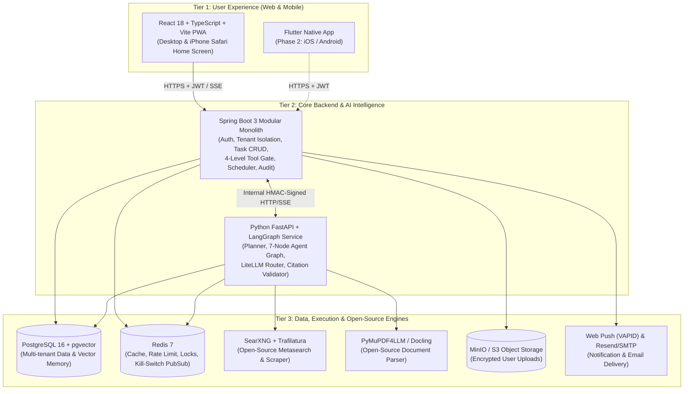
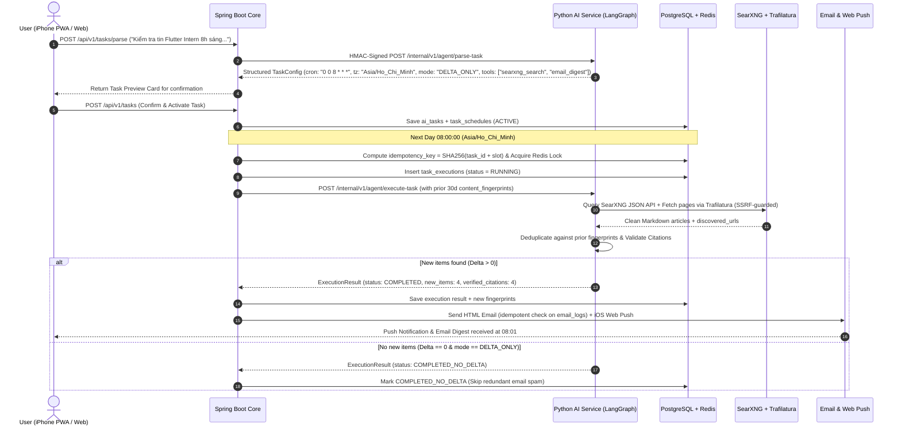

# System Architecture & Open-Source Integration Blueprint

**Project**: AI Life Assistant Platform (`AIFP`)  
**Architecture Style**: Spring Boot 3 Modular Monolith + Dedicated Python LangGraph AI Service + Open-Source Self-Hosted Tooling

---

## 1. High-Level 3-Tier Architecture

The platform separates **User Experience (Tier 1)**, **Business & Security Gatekeeping + AI Intelligence (Tier 2)**, and **Execution & Open-Source Integrations (Tier 3)**. We intentionally avoid premature microservices sprawl while isolating the Python AI orchestration runtime from the Java business/security core.

---

## 2. Strategic Open-Source Stack (Tối Ưu Chi Phí & Chất Lượng Bằng Mã Nguồn Mở)

Instead of paying for expensive proprietary APIs for every sub-function, AIFP integrates battle-tested open-source projects:

| Capability | Open-Source Project | License | Role in AIFP & Why Chosen |
| :--- | :--- | :--- | :--- |
| **Web Search Engine** | **SearXNG** (Dockerized) | AGPLv3 | Self-hosted metasearch aggregating Google, Bing, DuckDuckGo, GitHub, ArXiv, and Google News via JSON API at **$0/query**. Fallback to Tavily/Brave API when needed. |
| **Web Content Extraction** | **Trafilatura** + **BeautifulSoup4** | Apache-2.0 | Strips ads, navbars, and tracking scripts from HTML; extracts clean Markdown, author, date, and canonical URL locally in Python without paid scraping APIs. |
| **RSS / Atom Aggregation** | **feedparser** + **httpx** | BSD | Fast, lightweight polling of tech blogs, recruitment feeds, and news portals with ETag / `If-Modified-Since` caching. |
| **Agent Orchestration** | **LangGraph** | MIT | Stateful, cyclic graph execution with built-in checkpointing (`PostgresSaver`), ideal for **Human-in-the-Loop (HITL)** pause/resume on Level 3 tools. |
| **Model Router & Cost Guard** | **LiteLLM** / Custom Router | MIT | Unified interface over **Gemini 2.5 Flash/Pro** and **OpenAI GPT-4o-mini/4o**, providing automatic fallback, token counting, and budget enforcement. |
| **Document Parsing** | **PyMuPDF4LLM** | AGPL/Commercial | Converts PDFs and office documents into clean Markdown with page metadata in milliseconds on CPU. |
| **Vector Search & Hybrid RAG** | **pgvector** + PostgreSQL FTS | PostgreSQL | Runs inside the primary PostgreSQL instance (`HNSW` index + `tsvector` BM25 hybrid ranking)—eliminating external vector DB hosting costs. |
| **Distributed Job Scheduling** | **JobRunr** (or **Quartz**) | LGPL / Apache-2.0 | Persistent background jobs in Spring Boot backed by PostgreSQL + Redis locks, supporting cron timezones and retry backoff. |
| **Rate Limiting** | **Bucket4j** + Redis | Apache-2.0 | Token-bucket rate limiting per `user_id` and IP address at the Spring Boot API gateway filter. |
| **Web Push Protocol** | **web-push-java** (`nl.martijndwars`) | MIT | Standards-compliant RFC 8030 / VAPID encrypted Web Push delivery directly to Safari iOS 16.4+ and desktop browsers without requiring Firebase on Web. |

---

## 3. End-to-End Task Execution Sequence (Luồng Xử Lý Thực Tế)

Example: User creates task *"Kiểm tra tin tuyển dụng Flutter Intern tại TP.HCM mỗi sáng lúc 08:00 và gửi email nếu có tin mới."*

---

## 4. Service-to-Service Security Boundary (`Spring Boot <-> Python AI Service`)

1. **Network Isolation**: In Docker Compose / production VPC, `ai-service` (`port 8001`) is bound only to the internal backend network and is never exposed to the public internet.
2. **Signed Request Envelope**:
   - Every call from Spring Boot to Python includes:
     - `X-Internal-Timestamp`: Unix epoch seconds (reject if skew `> 60s`).
     - `X-User-Id`: Verified UUID from JWT.
     - `X-Execution-Id`: UUID for tracing and kill-switch cancellation.
     - `X-Internal-Signature`: `HMAC-SHA256(timestamp + "." + user_id + "." + raw_body, INTERNAL_SHARED_SECRET)`.
3. **Real-Time Kill Switch Propagation**:
   - Python `ai-service` subscribes to Redis channel `aifp:kill_switch`.
   - Before each LangGraph node transition and inside streaming loops, the worker checks if `user_id` or `execution_id` has been revoked. If triggered, it raises `TaskAbortedByKillSwitchException` within `< 1 second`.

