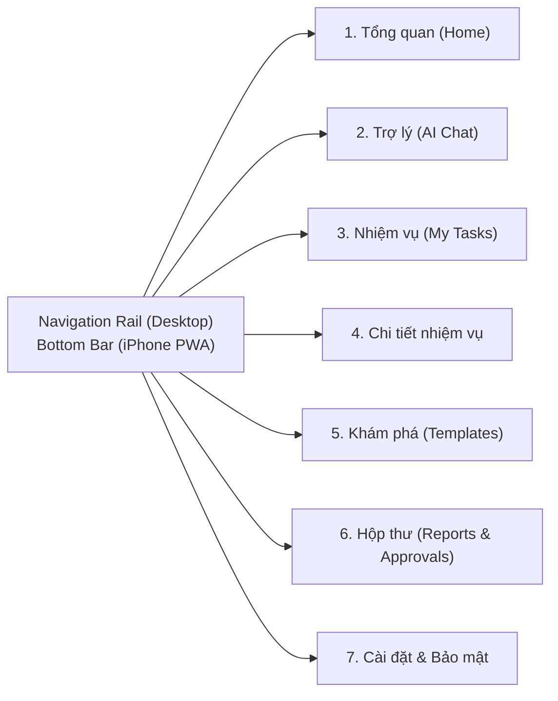

# UI/UX Design System & iOS Safari PWA Specification

**Design Philosophy**: Editorial Functional Minimalism (Inspired by **Linear, Things 3, Notion Calendar, and Raycast**)  
**Core Mandate**: Zero "AI Slop" visuals · Unified Token System · High Signal-to-Noise Ratio · Concise Microcopy

---

## 1. Why Typical "AI UIs" Fail & How AIFP Fixes It

| Common AI-Generated UI Mistake ("AI Slop") | AIFP Human-Crafted Standard |
| :--- | :--- |
| Neon purple/magenta/cyan glowing gradients everywhere | Calm warm-paper (`#F8F7F4`) & crisp ink (`#141413`) in Light mode; deep carbon (`#0C0D0E`) in Dark mode, with a single Forest Emerald (`#1F4E3D`) action accent. |
| Verbose helper paragraphs under every title (*"Chào mừng đến trang quản lý nhiệm vụ, nơi AI giúp bạn..."*) | **Zero redundant subtitles**. Section headers stand alone (`Nhiệm vụ`, `Hộp thư`, `Bộ nhớ`) with an inline count badge (`12`). |
| Long, wordy buttons (*"Nhấn vào đây để AI tạo nhiệm vụ tự động mới"*) | **Strict 1–3 word button rule**: `Tạo nhiệm vụ`, `Chạy thử`, `Tạm dừng`, `Duyệt gửi`, `Xóa`. |
| Inconsistent cards with 5 different border radii, heavy shadows, and ✨ icons on every badge | Single `1px solid var(--border-subtle)` border, flat surfaces, uniform `10px` card radius, and semantic status dots (`6px` circle). |
| Broken layout on iPhone Safari when virtual keyboard opens (`100vh` overflow) | Strict `100dvh` dynamic viewport, safe-area padding (`env(safe-area-inset-bottom)`), and `16px` minimum input font size to prevent iOS auto-zoom. |

---

## 2. Design Tokens (`src/styles/tokens.css`)

```css
:root {
  /* Surfaces - Warm Editorial Light */
  --bg-canvas: #F8F7F4;
  --bg-surface: #FFFFFF;
  --bg-elevated: #FFFFFF;
  --bg-subtle: #F1EFEA;
  --bg-active: #E8E5DD;

  /* Typography Ink */
  --text-primary: #141413;
  --text-secondary: #575653;
  --text-tertiary: #8C8A84;
  --text-inverse: #FFFFFF;

  /* Borders */
  --border-subtle: #E6E4DD;
  --border-strong: #CFCBC0;

  /* Brand & Semantic Accents */
  --accent-primary: #1F4E3D;      /* Deep Forest Emerald */
  --accent-primary-hover: #163A2D;
  --status-running: #0D9488;      /* Teal */
  --status-approval: #D97706;     /* Amber - HITL Approval Needed */
  --status-danger: #DC2626;       /* Crimson - Error / Kill Switch */

  /* Radii & Spacing */
  --radius-sm: 6px;
  --radius-md: 10px;
  --radius-lg: 14px;
  --font-sans: 'Plus Jakarta Sans', -apple-system, BlinkMacSystemFont, sans-serif;
  --font-mono: 'JetBrains Mono', monospace;
}

.dark {
  --bg-canvas: #0C0D0E;
  --bg-surface: #141618;
  --bg-elevated: #1C1F22;
  --bg-subtle: #1A1D20;
  --bg-active: #25292E;
  --text-primary: #F3F4F6;
  --text-secondary: #9CA3AF;
  --text-tertiary: #6B7280;
  --border-subtle: #24272C;
  --border-strong: #373B42;
  --accent-primary: #10B981;
  --accent-primary-hover: #059669;
}
```

---

## 3. Information Architecture & 7 Core Screens



### Screen-by-Screen Density & Microcopy Rules

1. **Tổng quan (`Home`)**:
   - **Top Command Composer**: Single unified input bar *"Giao việc hoặc hỏi bất kỳ điều gì..."* with quick-mode toggle (`Hỏi đáp` | `Tạo lịch tự động`) and button `Thực hiện`.
   - **3 Metric Strips (Compact)**: `Đang chạy (4)` · `Chờ duyệt (1)` · `Báo cáo mới (3)`.
   - **Recent Digest Feed**: Clean list showing Title, Source count (`5 nguồn`), Time (`08:00`), and `Xem`.
2. **Trợ lý (`AI Chat`)**:
   - Clean message stream without avatars cluttering narrow mobile screens.
   - **Source Pills**: Inline compact pills (`[1] topdev.vn`, `[2] itviec.com`) at the bottom of research responses; tapping opens the verified source drawer.
   - **Inline Task Proposal Card**: When the user asks to automate something in chat, render an interactive card with:
     - **Mục tiêu**: `Tìm việc Flutter Intern TP.HCM`
     - **Lịch chạy**: `08:00 hằng ngày (UTC+7)`
     - **Chế độ**: `Chỉ báo khi có tin mới`
     - **Actions**: `[Bật lịch]` (Primary) · `[Chỉnh sửa]` (Secondary).
3. **Nhiệm vụ (`My Tasks`) & Chi tiết (`Task Detail`)**:
   - Table/List row restricted to 4 elements: **Status Dot + Title**, **Schedule (`08:00 · Hằng ngày`)**, **Last Run (`4 tin mới · 2h trước`)**, and **Quick Toggle (`Switch`)**.
   - Task Detail view tabs: `Kết quả` · `Lịch sử chạy` · `Cấu hình`. Buttons: `Chạy ngay`, `Tạm dừng`, `Xóa`.
4. **Hộp thư (`Inbox`)**:
   - Unified feed with 3 filter pills: `Tất cả` · `Báo cáo` · `Cần duyệt`.
   - **HITL Approval Card**: Highlighted with a `2px` left Amber border, showing exact action details and `[Duyệt]` / `[Từ chối]`.
5. **Cài đặt & Bảo mật (`Settings`)**:
   - Sections: `Hồ sơ & Múi giờ`, `Bộ nhớ cá nhân` (table of memories with `[Duyệt]` / `[Xóa]`), `Quyền công cụ AI` (Level 1–3 toggles), `Thông báo iPhone PWA`, and a high-visibility red **`[Dừng khẩn cấp AI]` (Emergency Kill Switch)** button at the bottom.

---

## 4. iPhone Safari PWA Engineering Checklist

1. **Web App Manifest (`public/manifest.webmanifest`)**:
   - `"display": "standalone"`, `"orientation": "portrait"`, `"background_color": "#F8F7F4"`, `"theme_color": "#F8F7F4"`.
   - Include `apple-touch-icon` (`180x180px`) and `<meta name="apple-mobile-web-app-capable" content="yes">` in `index.html`.
2. **iOS 16.4+ Web Push Activation Flow**:
   - Detect `isIOS = /iPad|iPhone|iPod/.test(navigator.userAgent)` and `isStandalone = window.matchMedia('(display-mode: standalone)').matches || (window.navigator as any).standalone === true`.
   - If `isIOS && !isStandalone`: Show a clean step-by-step sheet:
     1. Nhấn biểu tượng **Chia sẻ (Share)** ở thanh dưới Safari.
     2. Chọn **Thêm vào Màn hình chính (Add to Home Screen)**.
     3. Mở ứng dụng từ Màn hình chính và bật **Thông báo**.
   - If `isStandalone`: Clicking `[Bật thông báo]` directly calls `Notification.requestPermission()` -> `registration.pushManager.subscribe({ userVisibleOnly: true, applicationServerKey: VAPID_PUBLIC_KEY })` -> `POST /api/v1/notifications/web-push/subscribe`.

